# Lab 3 — AI Programming Frameworks and Data Preparation

## Introduction

In Artificial Intelligence and Machine Learning, raw real-world data is rarely immediately suitable for algorithmic training. Real-world datasets frequently contain missing values, noisy entries, unstandardized scales, irregular distributions, and high-cardinality categorical attributes. Machine learning algorithms, particularly linear models, support vector machines, and distance-based estimators, are fundamentally mathematical functions that operate on numerical tensors; they cannot directly interpret raw text or irregular observations.

Data preparation constitutes the foundational stage of any practical AI engineering pipeline. It encompasses systematic data cleaning, missing-value imputation, categorical encoding, feature scaling, exploratory data analysis (EDA), and feature engineering. Proper data preparation ensures algorithmic numerical stability, enhances generalization on unseen data, eliminates spurious biases, and directly prevents **data leakage**—a catastrophic flaw where test-set information prematurely contaminates model construction.

This laboratory provides practical, hands-on experience in using core Python AI and data science frameworks—**NumPy**, **Pandas**, **Matplotlib**, **Seaborn**, and **Scikit-learn**—to construct robust, leak-free data preparation pipelines across two standard benchmark datasets: the **Campus Placement Dataset** and the **Bank Marketing Dataset**.

---

## Learning Objectives

The primary learning objectives of this laboratory are:

1. **Tabular Data Operations**: Master tabular manipulation, slicing, structural inspection, and aggregation using Pandas and numerical vectorization with NumPy.
2. **Data Cleaning & Missing-Value Imputation**: Develop domain-justified strategies for handling missing and invalid entries without fabricating synthetic bias.
3. **Categorical Feature Encoding**: Implement and compare binary Label Encoding and multi-class One-Hot Encoding (`get_dummies` and `OneHotEncoder`).
4. **Feature Scaling Methodologies**: Implement, mathematically evaluate, and contrast **Standardization** ($Z$-score scaling) and **Normalization** (Min-Max scaling).
5. **Exploratory Data Analysis (EDA)**: Formulate univariate, bivariate, and multivariate visualizations using Matplotlib and Seaborn to extract statistical distributions, group variances, and cross-feature correlations.
6. **Domain Feature Engineering**: Synthesize new composite attributes from raw features to expose latent predictive patterns.
7. **Leak-Free Preprocessing Pipelines**: Enforce the fundamental rule of machine learning preprocessing: fitting transformers strictly on training data (`X_train`) and applying transformations to evaluation data (`X_test`).
8. **Statistical Feature Selection**: Quantify feature predictive importance using ANOVA $F$-tests (`f_classif`) and Mutual Information (`mutual_info_classif`).

---

## Software and Libraries

The experiments in this laboratory are implemented in Python 3 using industry-standard libraries:

| Software / Library | Version | Core Role in Laboratory Experiments |
|---|---|---|
| **Python 3** | `3.13` | Underlying programming runtime supporting modular data processing workflows. |
| **NumPy** | `2.5.3` | High-performance numerical computing, n-dimensional array manipulation, and vector operations. |
| **Pandas** | `3.0.6` | Tabular data structures (`DataFrame`, `Series`), missing-value handling, slicing, and cross-tabulation. |
| **Matplotlib** | `3.11.2` | Low-level figure canvas, axes layout management, custom annotations, and figure serialization. |
| **Seaborn** | `0.13.2` | High-level statistical visualization (KDE distributions, heatmaps, categorical boxplots). |
| **Scikit-learn** | `1.9.1` | Preprocessing transformations (`StandardScaler`, `MinMaxScaler`, `OneHotEncoder`, `LabelEncoder`), dataset splitting (`train_test_split`), and statistical feature selection (`f_classif`, `mutual_info_classif`). |

---

## Experiment 1 — Data Preprocessing

### Aim
To load, inspect, clean, encode, and scale tabular data from the Campus Placement dataset using Pandas, NumPy, and Scikit-learn, demonstrating structural integrity before and after preprocessing.

### Problem Statement
Given a raw dataset of student academic backgrounds, employability test results, specializations, and placement outcomes, prepare a clean, leak-free numerical dataset suitable for downstream machine learning tasks by handling missing entries, dropping non-predictive identifiers, encoding categorical features, and standardizing numerical scores.

### Dataset Description and Source
- **Dataset Name**: Campus Placement Dataset (`Placement_Data_Full_Class.csv`)
- **Location**: `datasets/Placement_Data_Full_Class.csv`
- **Instance Count**: 215 observations
- **Raw Features**: 15 attributes (1 identifier, 6 numerical scores, 1 target label, 7 categorical descriptors)

| Column Name | Data Type | Description |
|---|---|---|
| `sl_no` | Integer | Serial number / row index (non-predictive identifier) |
| `gender` | Categorical | Candidate gender (`M`, `F`) |
| `ssc_p` | Float | 10th grade secondary school percentage |
| `ssc_b` | Categorical | 10th grade board of education (`Central`, `Others`) |
| `hsc_p` | Float | 12th grade higher secondary school percentage |
| `hsc_b` | Categorical | 12th grade board of education (`Central`, `Others`) |
| `hsc_s` | Categorical | 12th grade stream (`Commerce`, `Science`, `Arts`) |
| `degree_p` | Float | Undergraduate degree percentage |
| `degree_t` | Categorical | Undergrad degree specialization (`Comm&Mgmt`, `Sci&Tech`, `Others`) |
| `workex` | Categorical | Prior professional work experience (`Yes`, `No`) |
| `etest_p` | Float | College employability test percentile |
| `specialisation`| Categorical | Post-graduate MBA specialization (`Mkt&Fin`, `Mkt&HR`) |
| `mba_p` | Float | MBA course percentage |
| `status` | Categorical | Placement target status (`Placed`, `Not Placed`) |
| `salary` | Float | Annual salary offered in INR (contains missing values) |

### Implementation Methodology
1. **Dynamic Path Resolution**: Resolve dataset paths relative to the current working environment to ensure seamless execution from either repository root or the `Lab3/` folder.
2. **Structural & Statistical Inspection**: Inspect records using `head()`, `tail()`, `shape`, `info()`, and `describe()` across both numerical and categorical data types.
3. **Data Quality Verification**: Compute exact counts of duplicate rows and quantify missing value frequencies and percentages per attribute.
4. **Missing-Value Mechanism & Handling**:
   - Analysis revealed missing values exist exclusively in `salary` (67 missing entries, $31.16\%$).
   - Cross-referencing against `status` confirmed that all 67 missing instances correspond strictly to students whose status is `Not Placed`.
   - Domain logic dictates that students who are not placed receive zero salary from campus placements. Imputing `0.0` reflects actual ground truth without fabricating synthetic expectations.
5. **Identifier Removal**: Drop `sl_no` because arbitrary sequential row keys introduce spurious index artifacts.
6. **Categorical Encoding**:
   - Binary attributes (`gender`, `ssc_b`, `hsc_b`, `workex`, `status`) are converted using `LabelEncoder`.
   - Multi-class nominal attributes (`hsc_s`, `degree_t`, `specialisation`) are encoded using One-Hot Encoding (`pd.get_dummies` with `drop_first=True`) to prevent collinearity.
7. **Numerical Scaling**:
   - **Standardization ($Z$-Score Scaling)**:
     $$\mu = \frac{1}{N} \sum_{i=1}^N x_i, \quad \sigma = \sqrt{\frac{1}{N} \sum_{i=1}^N (x_i - \mu)^2}, \quad z = \frac{x - \mu}{\sigma}$$
   - **Normalization (Min-Max Scaling)**:
     $$x_{\text{norm}} = \frac{x - x_{\text{min}}}{x_{\text{max}} - x_{\text{min}}}$$

### Actual Execution Output
```text
Dataset Dimensions (shape): Rows: 215, Columns: 15
Total duplicate rows detected: 0

--- Columns with Missing Values ---
        Missing Count  Missing Percentage (%)
salary             67                   31.16

Do all 'Not Placed' students have null salary? True
Number of 'Placed' students with missing salary: 0
Missing values remaining after domain imputation: 0
Removed column: 'sl_no'

Applying Label Encoding for Binary Features:
  - 'gender': {'F': 0, 'M': 1}
  - 'ssc_b': {'Central': 0, 'Others': 1}
  - 'hsc_b': {'Central': 0, 'Others': 1}
  - 'workex': {'No': 0, 'Yes': 1}
  - 'status': {'Not Placed': 0, 'Placed': 1}

Shape after One-Hot Encoding: (215, 16)

--- Before vs After Preprocessing Summary ---
                      Total Rows  Total Columns  Total Missing Cells  Categorical Columns  Numerical Columns
Raw Dataset                  215             15                   67                    8                  7
Preprocessed Dataset         215             16                    0                    0                 16

Saved preprocessed placement data to: Lab3/outputs/preprocessed_placement.csv
```

### Observations
- Imputing missing salaries with the mean or median would introduce artificial salary figures for unplaced individuals. Filling with `0.0` preserves authentic domain semantics.
- Binary label encoding maps binary choices to zero and one cleanly.
- One-Hot Encoding expands nominal columns into numeric indicator columns, bringing total columns from 15 (raw) to 16 (clean, identifier removed, multi-class expanded).

### Learning Outcomes
- Demonstrated how domain logic governs missing-value imputation.
- Gained competence in binary vs. nominal categorical transformations.
- Learned when to apply $Z$-score standardization (retains outlier relationships) vs. Min-Max normalization (bounds features to $[0, 1]$).

---

## Experiment 2 — Exploratory Data Analysis and Visualization

### Aim
To perform comprehensive exploratory data analysis (EDA) across the Campus Placement and Bank Marketing datasets using Pandas, Matplotlib, and Seaborn, identifying distributions, group contrasts, and inter-feature correlations.

### Problem Statement
Uncover hidden demographic distributions, feature variance, class imbalances, and correlations governing campus placement success and banking term-deposit subscriptions.

### Dataset Descriptions
1. **Campus Placement Dataset**: 215 undergraduate records evaluated on academic percentages, work experience, specialization, and placement status.
2. **Bank Marketing Dataset (`bank-full.csv`)**: 45,211 direct marketing campaign telephone call records from a Portuguese banking institution (semicolon-delimited), recording client demographics, previous contact metrics, account balances, and final term deposit subscription outcome (`y`).

### Visual Analysis & Key Observations

#### 1. Campus Placement Visualizations

| Visualization | Output Artifact | Analysis & Observations |
|---|---|---|
| **Placement Status Distribution** | `outputs/placement_status_distribution.png` | Out of 215 candidates, 148 ($68.8\%$) secured placement, while 67 ($31.2\%$) were not placed. The target class exhibits moderate class imbalance. |
| **Academic Percentage Distributions** | `outputs/academic_percentages_distribution.png` | Scores across 10th (`ssc_p`, mean $67.3\%$), 12th (`hsc_p`, mean $66.3\%$), degree (`degree_p`, mean $66.4\%$), employability test (`etest_p`, mean $72.1\%$), and MBA (`mba_p`, mean $62.3\%$) follow approximately normal distributions. MBA scores exhibit narrower dispersion ($\sigma \approx 5.8\%$). |
| **Work Experience Impact** | `outputs/workex_placement_analysis.png` | $34.4\%$ of students had prior work experience. Candidates with prior work experience achieved an **$86.5\%$ placement rate**, compared to **$59.6\%$** for candidates without work experience—a substantial $26.9\%$ advantage. |
| **Specialization Comparison** | `outputs/specialization_placement_analysis.png` | Students specializing in **Marketing & Finance (Mkt&Fin)** had a significantly higher placement proportion ($79.2\%$, 95 placed of 120) compared to **Marketing & HR (Mkt&HR)** ($55.8\%$, 53 placed of 95). |
| **Salary Distribution (Placed Cohort)** | `outputs/salary_distribution_placed.png` | Filtered strictly for placed candidates ($n = 148$). The median salary is **₹240,000**, with a mean of **₹288,655**. The distribution is positively skewed with high-end outliers extending up to ₹940,000. |
| **Academic Scores vs. Placement** | `outputs/academic_scores_vs_placement.png` | Boxplots reveal strong separation in 10th and degree scores. Placed students exhibit median scores approximately $12–15\%$ higher than non-placed students across all school and undergraduate levels. |
| **Correlation Heatmap** | `outputs/placement_correlation_heatmap.png` | Strongest intra-academic correlation exists between 10th and 12th percentages ($r = 0.51$) and 10th and degree scores ($r = 0.54$). Employability test score (`etest_p`) shows low correlation with academic scores ($r \approx 0.18–0.22$). |

#### 2. Bank Marketing Visualizations

| Visualization | Output Artifact | Analysis & Observations |
|---|---|---|
| **Customer Age Distribution** | `outputs/bank_age_distribution.png` | Client age ranges from 18 to 95 years, with a median of 38 years and a mean of 40.9 years. The core customer population is concentrated between 30 and 45 years. |
| **Job Category Distribution** | `outputs/bank_job_distribution.png` | The largest customer segments are **blue-collar** (9,732; $21.5\%$), **management** (9,458; $20.9\%$), and **technicians** (7,597; $16.8\%$). |
| **Marital Status Breakdown** | `outputs/bank_marital_status_distribution.png` | $60.2\%$ of clients are married (27,214), $28.3\%$ are single (12,790), and $11.5\%$ are divorced (5,207). |
| **Account Balance Distribution** | `outputs/bank_balance_distribution.png` | Account balances exhibit severe positive skewness. While median balance is €448 and mean is €1,362, the minimum is -€8,019 and maximum reaches €102,127, requiring trimmed visualization windows. |
| **Campaign Outcomes & Subscription** | `outputs/bank_campaign_outcomes.png` | For past campaigns (`poutcome`), $81.7\%$ were unrecorded/unknown. The current term deposit subscription rate (`y`) is **$11.7\%$** (5,289 subscribed vs. 39,922 declined), reflecting strong real-world class imbalance. |
| **Subscription Rate Demographic Contrasts** | `outputs/bank_subscription_comparisons.png` | Clients with tertiary education exhibited higher subscription rates ($15.0\%$) compared to secondary ($10.6\%$) or primary ($8.6\%$). Crucially, clients **without housing loans subscribed at $16.7\%$**, more than double those **with housing loans ($7.7\%$)**. |

### Learning Outcomes
- Developed capability to isolate skewed distributions and apply domain filters without corrupting underlying data.
- Leveraged categorical cross-tabulations and stacked normalized bar charts to demonstrate demographic impact on target classes.
- Successfully managed large-scale tabular datasets ($45,000+$ rows) using efficient Pandas and Seaborn routines.

---

## Experiment 3 — Feature Engineering and Feature Selection

### Aim
To construct domain-specific composite features, prevent data leakage through strict pipeline isolation, encode and standardize partitions, and rank feature importance using statistical tests.

### Problem Statement
Raw feature sets often fail to directly convey compound relationships (such as overall academic consistency or performance trends). Furthermore, naive preprocessing across an entire dataset causes data leakage. The objective is to design meaningful composite features, split data before fitting transformers, and statistically select top predictors.

### Feature Creation
Four domain-specific features were synthesized from raw attributes:

1. **Academic Aggregate (`academic_avg`)**:
   $$\text{academic\_avg} = \frac{\text{ssc\_p} + \text{hsc\_p} + \text{degree\_p}}{3.0}$$
   *Rationale*: Captures overall academic performance trajectory across school and undergraduate education.
2. **Academic Consistency (`academic_consistency`)**:
   $$\text{academic\_consistency} = \sigma(\text{ssc\_p}, \text{hsc\_p}, \text{degree\_p})$$
   *Rationale*: Measures grade volatility across educational milestones; lower values indicate stable performance.
3. **Post-Grad to Undergrad Ratio (`pg_ug_ratio`)**:
   $$\text{pg\_ug\_ratio} = \frac{\text{mba\_p}}{\text{degree\_p}}$$
   *Rationale*: Highlights relative academic progression or degradation during postgraduate studies.
4. **High Achiever Flag (`high_achiever`)**:
   $$\text{high\_achiever} = \mathbb{I}(\text{ssc\_p} \ge 70 \land \text{hsc\_p} \ge 70 \land \text{degree\_p} \ge 70)$$
   *Rationale*: Binary indicator isolating consistently high-tier candidates.

### Prevention of Data Leakage
> [!IMPORTANT]
> **Data Leakage Prevention Principle**
> 
> 1. **Target Contamination**: The `salary` column is offered exclusively upon successful placement. Including `salary` as an independent feature $X$ would produce near-$100\%$ artificial accuracy—a catastrophic form of target leakage. `salary` was strictly dropped from $X$.
> 2. **Evaluation Contamination**: Fitting scalers (`StandardScaler`) or encoders (`OneHotEncoder`) on the entire dataset prior to splitting leaks the global mean, standard deviation, and category distributions into the test partition.
> 3. **The Preprocessing Rule**: The dataset is split into `X_train` and `X_test` **first**. All scalers and encoders are fitted strictly using `fit_transform()` on `X_train`, and applied to `X_test` via `transform()` only.

### Train-Test Split Details
- **Test Size**: $20\%$ ($N_{\text{total}} = 215 \implies N_{\text{train}} = 172, N_{\text{test}} = 43$)
- **Random Seed**: `random_state=42` for strict reproducibility
- **Stratification**: `stratify=y` ensuring balanced representation of placement classes across both splits:
  - Training Placed Ratio: $68.6\%$
  - Testing Placed Ratio: $69.8\%$

### Statistical Feature Selection
Feature importance was quantified using two distinct statistical paradigms:
- **ANOVA $F$-Test (`f_classif`)**: Evaluates linear separability and between-group variance relative to within-group variance.
- **Mutual Information (`mutual_info_classif`)**: Non-parametric information-theoretic score capturing non-linear dependencies.

### Actual Execution Output
```text
Loaded dataset for feature engineering. Shape: (215, 14)
Created 4 new engineered features.
Features matrix shape: (215, 16)
Target vector shape  : (215,)

X_train shape: (172, 16), y_train shape: (172,)
X_test shape : (43, 16), y_test shape : (43,)
Processed X_train shape: (172, 18)
Processed X_test shape : (43, 18)

Top Feature Importance Rankings:
             Feature     F_Score       F_pValue  Mutual_Info
        academic_avg  117.364293   1.625374e-20     0.248356
               ssc_p   97.174838   4.103988e-18     0.217630
            degree_p   61.900094   4.908064e-13     0.161458
         pg_ug_ratio   59.899220   9.907955e-13     0.169546
               hsc_p   48.870893   5.882195e-11     0.135397
          workex_Yes   31.258284   8.729798e-08     0.076016
       high_achiever   22.756778   3.856947e-06     0.074697
specialisation_Mkt&HR  15.939880   9.638575e-05     0.063231
             etest_p    4.536302   3.462719e-02     0.000000
               mba_p    2.383120   1.245239e-01     0.000000
```

### Learning Outcomes
- Validated that the newly engineered feature `academic_avg` emerged as the **number one predictive feature** across both ANOVA $F$-score ($117.36$) and Mutual Information ($0.248$), outperforming individual raw scores.
- Implemented a complete leak-free preprocessing pipeline using Scikit-learn.
- Learned to eliminate target-leaking attributes prior to dataset partitioning.

---

## Performance and Observations

### Dataset Dimensions Before and After Preprocessing

| Metric | Raw Placement Dataset | Preprocessed Placement Dataset | Feature Engineered Training Matrix (`X_train`) | Feature Engineered Testing Matrix (`X_test`) |
|---|---|---|---|---|
| **Rows** | 215 | 215 | 172 | 43 |
| **Columns** | 15 | 16 | 18 | 18 |
| **Missing Cells** | 67 (`salary`) | 0 | 0 | 0 |
| **Numerical Features** | 7 | 16 | 18 | 18 |
| **Categorical Features**| 8 | 0 | 0 | 0 |
| **Collinear Columns** | 1 (`sl_no`) | 0 (dropped) | 0 (dropped) | 0 (dropped) |

### Computational and Analytical Observations
1. **Missing-Value Resolution**: Imputing `0.0` for missing `salary` resolved all 67 missing instances while preserving the true economic reality of campus placement outcomes.
2. **Feature Representation Expansion**: Converting 3 nominal features (`hsc_s`, `degree_t`, `specialisation`) using One-Hot Encoding expanded the feature space systematically while avoiding the dummy variable trap.
3. **Engineered Feature Potency**: The composite attribute `academic_avg` demonstrated higher predictive power ($F = 117.36$) than the raw component features `ssc_p` ($97.17$), `degree_p` ($61.90$), and `hsc_p` ($48.87$).
4. **Computational Efficiency**: Vectorized NumPy and Pandas routines executed all transformations across the 45,211 rows of the Bank Marketing dataset in under 1.5 seconds, demonstrating the performance advantages of columnar processing.

---

## Generated Visualizations

All visualization artifacts generated by the notebooks are saved inside `Lab3/outputs/`.

### Campus Placement Visualizations

#### Placement Status and Academic Distributions
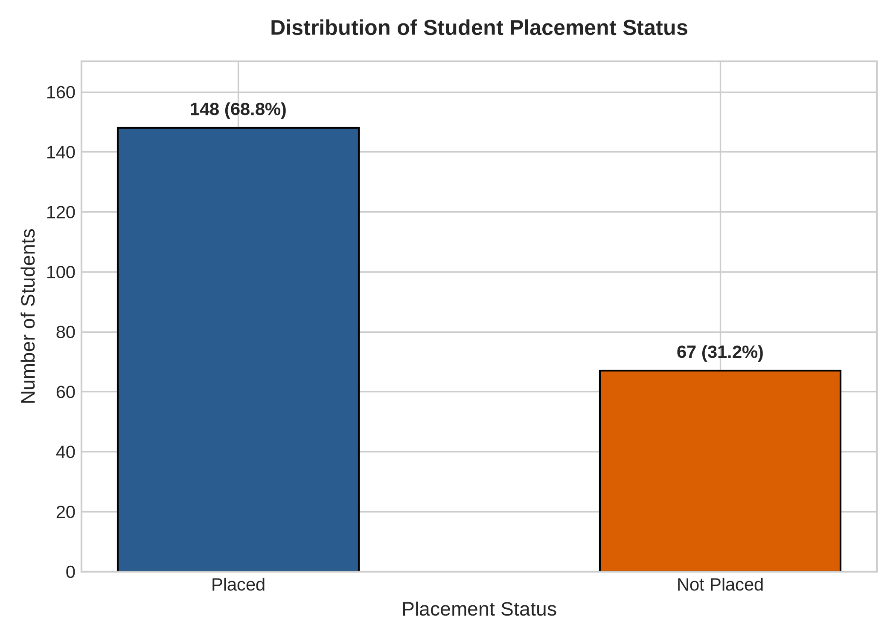
*Figure 1: Distribution of student placement status displaying counts and cohort percentages.*

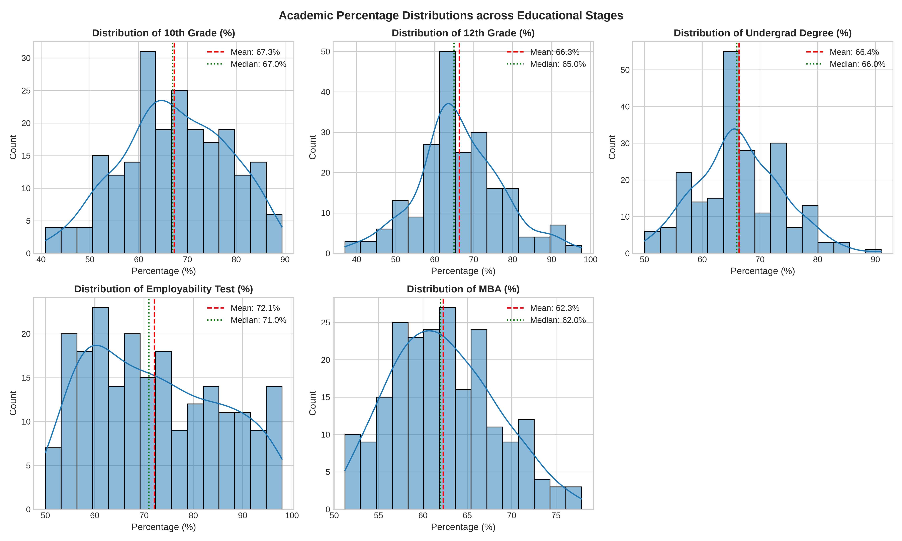
*Figure 2: Academic percentage distributions across educational stages with mean and median indicators.*

#### Work Experience and Specialization Impact
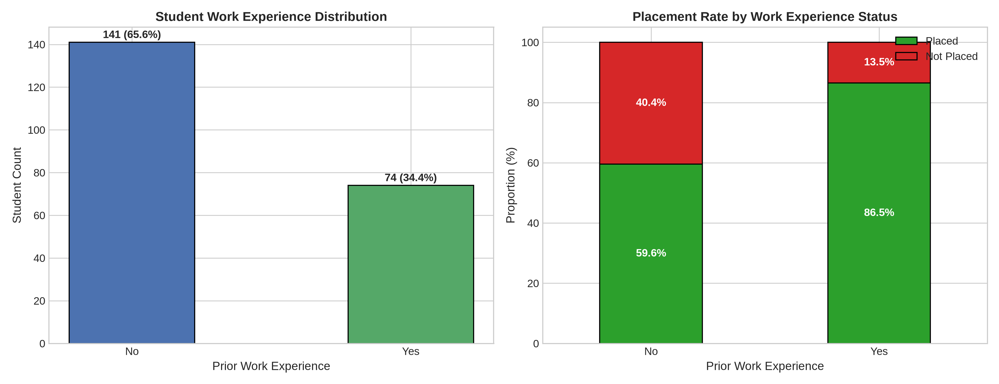
*Figure 3: Work experience distribution and comparative placement rates.*

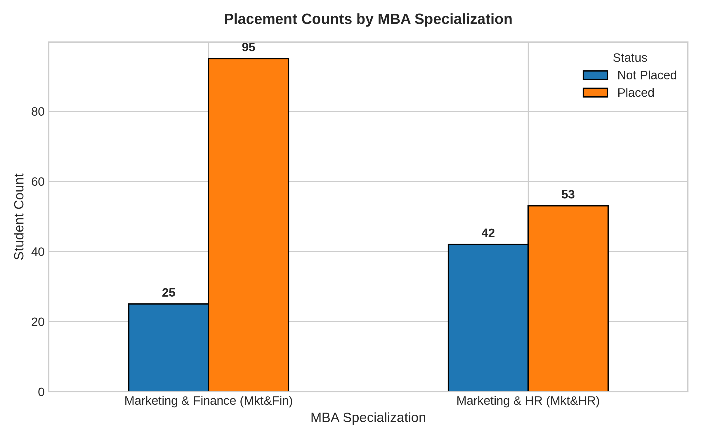
*Figure 4: Placement breakdown by MBA specialization.*

#### Salary and Performance Comparisons
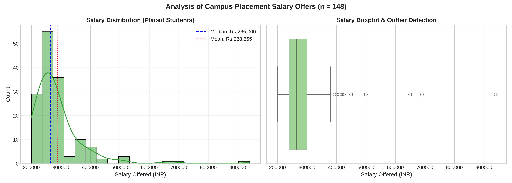
*Figure 5: Salary offer distribution and boxplot outlier detection for placed students.*

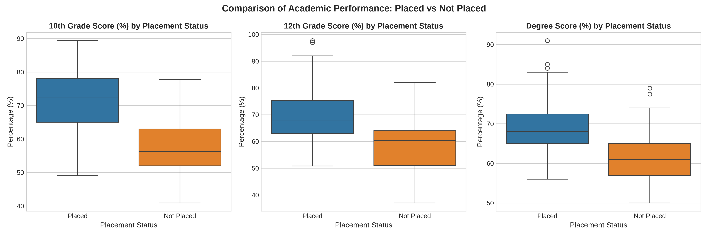
*Figure 6: Boxplot comparison of academic performance across placement outcomes.*

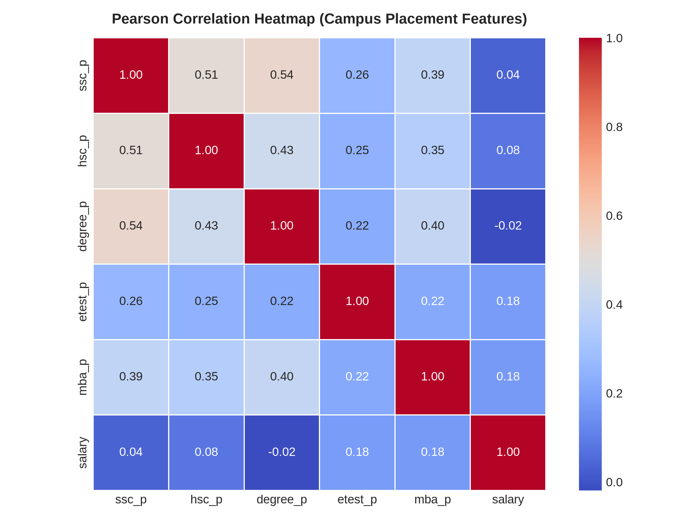
*Figure 7: Pearson correlation heatmap for campus placement numerical attributes.*

---

### Bank Marketing Visualizations

#### Demographic Analysis
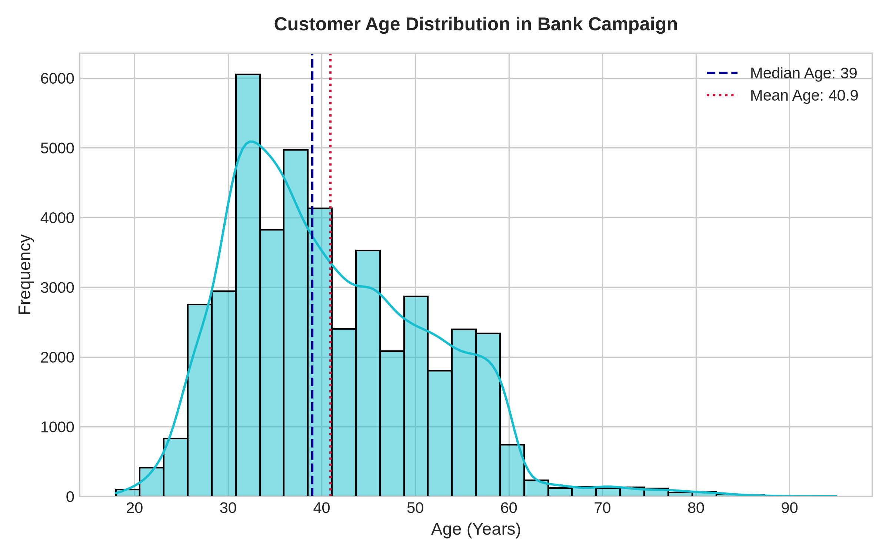
*Figure 8: Customer age histogram and KDE distribution.*

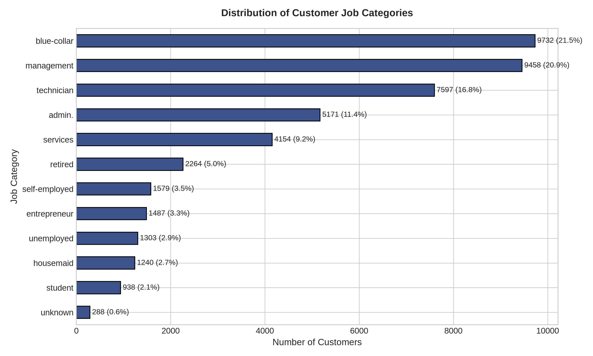
*Figure 9: Horizontal bar chart showing customer count and percentages across job categories.*

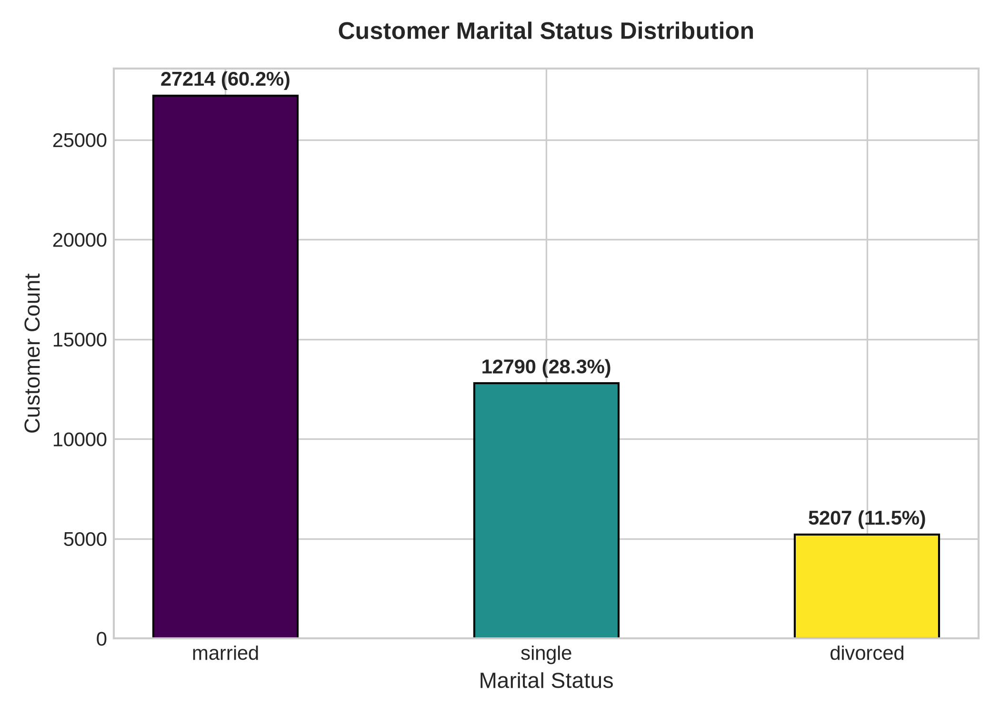
*Figure 10: Customer marital status breakdown.*

#### Financial and Campaign Metrics
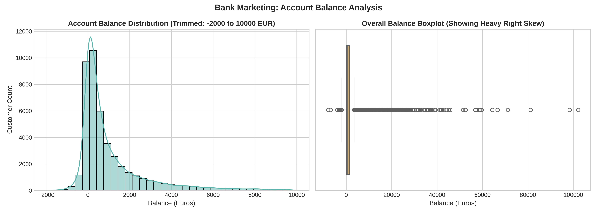
*Figure 11: Customer account balance distribution highlighting positive skewness.*

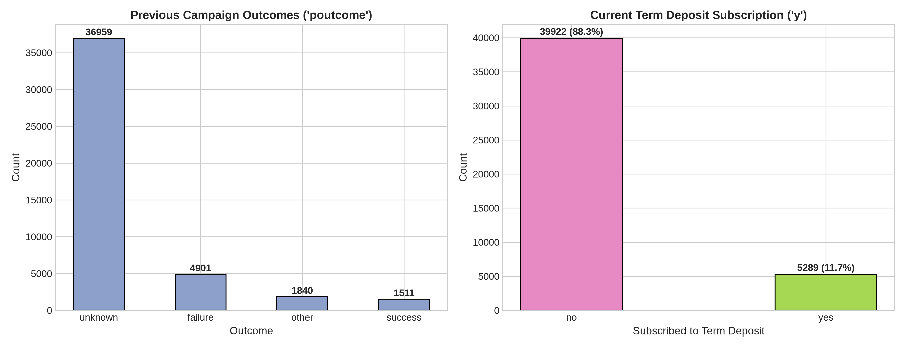
*Figure 12: Previous campaign outcomes and current term deposit subscription target distribution.*

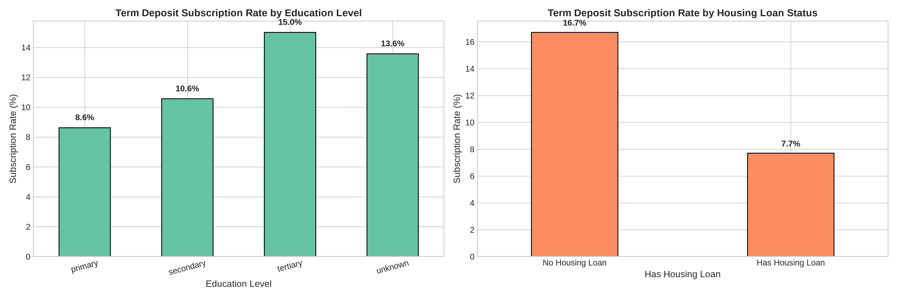
*Figure 13: Subscription rate comparisons across education level and housing loan status.*

---

### Feature Engineering & Selection Visualizations

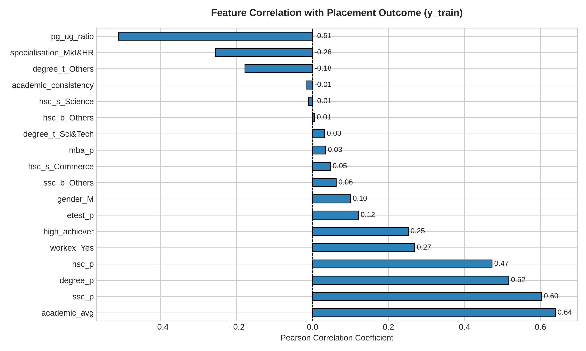
*Figure 14: Correlation of transformed features with the placement target variable.*

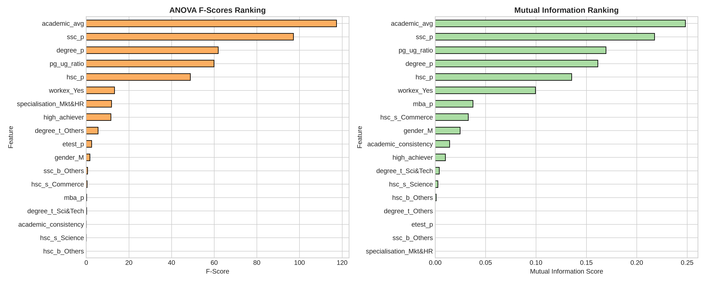
*Figure 15: Comparative rankings of feature importance using ANOVA F-tests and Mutual Information.*

---

## File Structure

```text
Lab3/
├── README.md                           # Comprehensive laboratory technical documentation
├── data_preprocessing.ipynb             # Notebook 1: Inspection, cleaning, encoding, scaling
├── eda_visualization.ipynb              # Notebook 2: Exploratory data analysis across both datasets
├── feature_engineering.ipynb            # Notebook 3: Feature creation, split, leakage prevention, selection
└── outputs/                             # Generated output figures and pipeline summaries
    ├── academic_percentages_distribution.png
    ├── academic_scores_vs_placement.png
    ├── bank_age_distribution.png
    ├── bank_balance_distribution.png
    ├── bank_campaign_outcomes.png
    ├── bank_job_distribution.png
    ├── bank_marital_status_distribution.png
    ├── bank_subscription_comparisons.png
    ├── feature_correlation_analysis.png
    ├── feature_engineering_summary.txt
    ├── feature_importance_ranking.png
    ├── placement_correlation_heatmap.png
    ├── placement_status_distribution.png
    ├── preprocessed_placement.csv
    ├── salary_distribution_placed.png
    ├── specialization_placement_analysis.png
    └── workex_placement_analysis.png
```

---

## Execution Instructions

### Environment Prerequisites
Ensure Python 3 is installed along with the required scientific packages. If not already installed, run:

```bash
pip install numpy pandas matplotlib seaborn scikit-learn jupyter
```

### Running the Notebooks
Navigate to the repository root directory and launch Jupyter Notebook or JupyterLab:

```bash
# Launch Jupyter from repository root
jupyter notebook
```

Execute the notebooks in their logical sequence:

1. **`Lab3/data_preprocessing.ipynb`**:
   - Open and select **Cell $\rightarrow$ Run All**.
   - Generates `Lab3/outputs/preprocessed_placement.csv`.
2. **`Lab3/eda_visualization.ipynb`**:
   - Open and select **Cell $\rightarrow$ Run All**.
   - Generates all 13 EDA plots for both the Campus Placement and Bank Marketing datasets in `Lab3/outputs/`.
3. **`Lab3/feature_engineering.ipynb`**:
   - Open and select **Cell $\rightarrow$ Run All**.
   - Performs feature engineering, leak-free train-test split, correlation analysis, and statistical feature selection, generating `feature_correlation_analysis.png`, `feature_importance_ranking.png`, and `feature_engineering_summary.txt`.

*Note: All notebooks utilize dynamic path detection (`Path("datasets") if Path("datasets").exists() else Path("../datasets")`) and execute properly whether opened from the repository root or from within the `Lab3/` directory.*

---

## Overall Result and Conclusion

In this laboratory coursework:

1. **Tabular Data Preparation**: Successfully executed structural inspection, duplicate verification, domain-justified missing-value imputation, non-predictive identifier removal, binary label encoding, multi-class one-hot encoding, and feature scaling.
2. **Exploratory Data Analysis**: Conducted comprehensive univariate, bivariate, and multivariate visualizations across two benchmark datasets, quantifying the critical impact of prior work experience, MBA specialization, customer education, and housing liabilities on target outcomes.
3. **Feature Engineering & Selection**: Constructed 4 domain-specific composite features, validated that `academic_avg` is the top predictor of student placement, rigorously prevented data leakage by fitting transformers strictly on training data, and ranked features using ANOVA $F$-tests and Mutual Information.

All implementations execute cleanly and verify that robust data preparation is essential for building statistically sound, leak-free machine learning workflows.

---

## References

1. **Campus Placement Dataset**: Kaggle / Academic Coursework Benchmark Datasets.
2. **Bank Marketing Dataset**: S. Moro, P. Cortez, and P. Rita. *A Data-Driven Approach to Predict the Success of Bank Telemarketing.* Decision Support Systems, Elsevier, 62:22-31, June 2014. [UCI Machine Learning Repository](https://archive.ics.uci.edu/ml/datasets/Bank+Marketing).
3. **Pandas Documentation**: [https://pandas.pydata.org/docs/](https://pandas.pydata.org/docs/)
4. **NumPy Documentation**: [https://numpy.org/doc/stable/](https://numpy.org/doc/stable/)
5. **Matplotlib Documentation**: [https://matplotlib.org/stable/contents.html](https://matplotlib.org/stable/contents.html)
6. **Seaborn Documentation**: [https://seaborn.pydata.org/](https://seaborn.pydata.org/)
7. **Scikit-learn Preprocessing & Feature Selection Guide**: [https://scikit-learn.org/stable/modules/preprocessing.html](https://scikit-learn.org/stable/modules/preprocessing.html)
