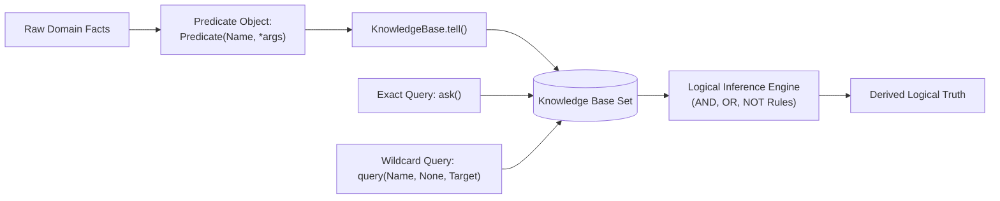
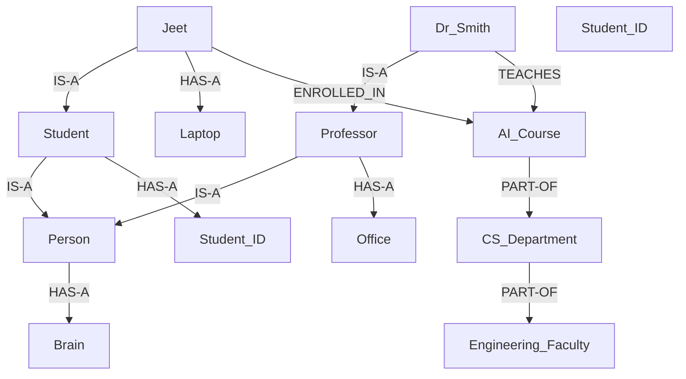
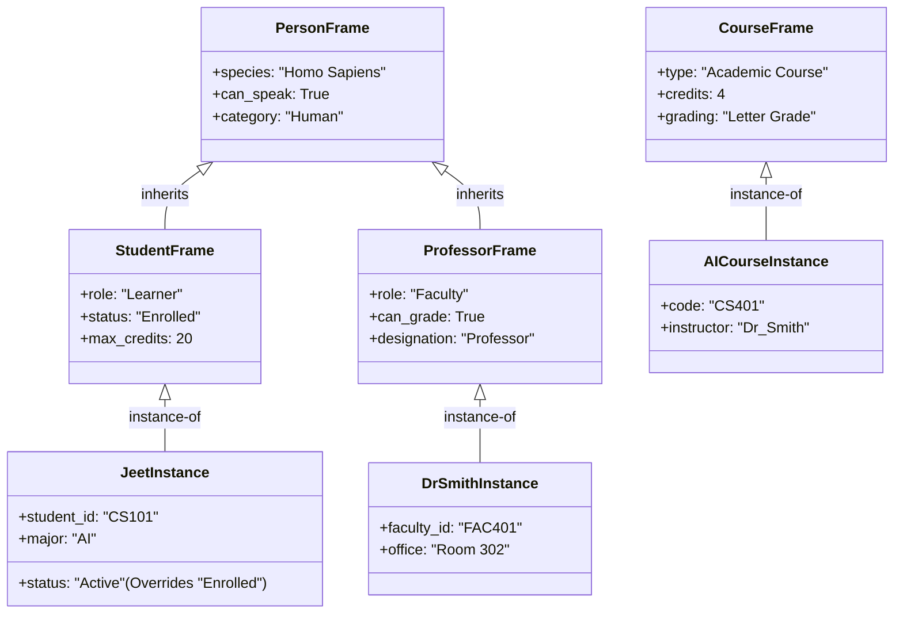
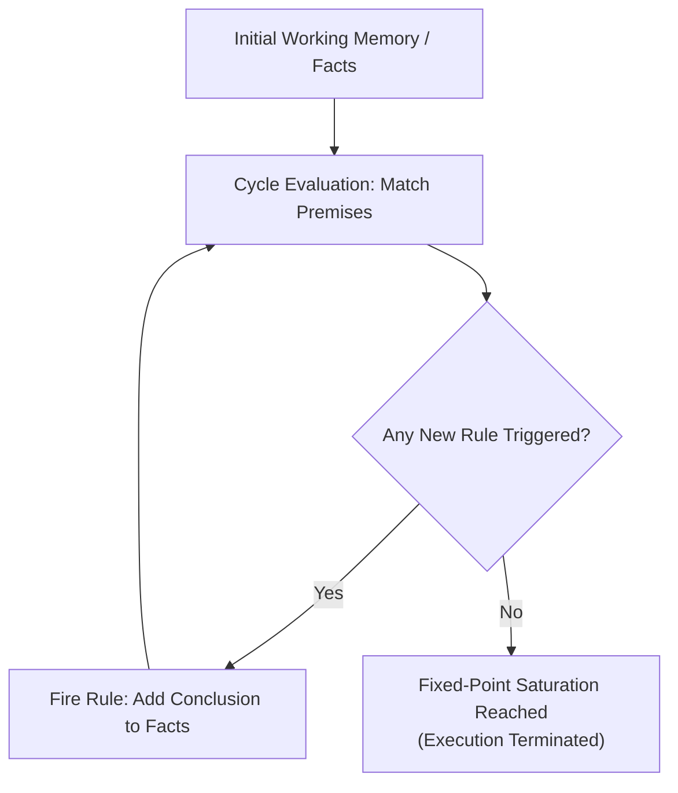

# Lab 4 — Knowledge Representation and Logical Reasoning

## Introduction

In Artificial Intelligence, **Knowledge Representation (KR)** is the formal study of how an autonomous agent translates information about the real world into computational structures that reasoning algorithms can interpret, manipulate, and infer from. While sub-symbolic approaches (such as deep neural networks) represent knowledge implicitly through numerical weight matrices, **symbolic knowledge representation** models concepts, facts, entities, and relationships explicitly using well-defined formal semantics.

Symbolic representation addresses the fundamental challenge of the **semantic gap**—bridging high-level human conceptualization with machine-executable computation. A robust knowledge representation scheme must balance two opposing forces:
1. **Representational Adequacy**: The ability to capture and express all necessary domain knowledge, nuances, constraints, and relational taxonomies.
2. **Inferential Efficiency**: The tractability of searching, querying, and deriving new knowledge within reasonable computational time and space bounds.

Historically, classical AI developed four foundational paradigms to structure domain knowledge:
- **Predicate Logic**: A formal mathematical framework providing precise declarative syntax, truth-theoretic semantics, and sound inference rules (Modus Ponens, resolution).
- **Semantic Networks**: Associative graph structures where nodes represent entities or concepts and directed edges represent explicit semantic relationships.
- **Frames**: Object-centered schemas that group attributes, default assumptions, constraints, and inheritance hierarchies into structured slots.
- **Rule-Based Systems**: Production systems governed by declarative condition-action (`IF-THEN`) pairs evaluated through forward or backward chaining inference engines.

This laboratory provides a comprehensive, hands-on study of these core knowledge representation methodologies by designing and evaluating a University Knowledge Base, an educational medical reasoning system, and Roger Schank's Conceptual Dependency model using pure Python 3.

---

## Learning Objectives

The primary learning objectives of this laboratory are:

1. **Predicate Logic Formulation**: Represent domain facts, relations, and truth conditions using first-order predicates ($P(t_1, t_2, \dots, t_n)$) and store them in an indexed Knowledge Base.
2. **First-Order Querying & Pattern Matching**: Implement exact and wildcard unification queries (`ask` and `query`) to extract variable bindings from stored assertions.
3. **Connective Inference**: Formulate logical deduction rules employing fundamental logical operators: Conjunction ($\wedge$ / `AND`), Disjunction ($\vee$ / `OR`), and Negation ($\neg$ / `NOT`).
4. **Graph-Based Knowledge Engineering**: Construct semantic networks using directed associative graphs featuring taxonomic (`IS-A`), possessive (`HAS-A`), and structural (`PART-OF`) links.
5. **Transitive Property Inheritance**: Implement graph traversal algorithms along taxonomic chains to enable automated property inheritance without redundant data storage.
6. **Schema-Based Frame Systems**: Model hierarchical entities using frames with slots, facet defaults, local attribute overrides, and recursive parent slot lookup.
7. **Forward-Chaining Rule Engines**: Construct a production rule engine that evaluates active premises against working memory across iterative cycles until fixed-point saturation.
8. **Conceptual Dependency (CD) Modeling**: Deconstruct natural language semantic actions into language-independent primitive ACTs (e.g., `ATRANS`) and conceptual role matrices.

---

## Software Requirements

All experiments in this laboratory are implemented using Python 3 and depend exclusively on the Python Standard Library:

| Component | Version / Requirement | Role in Laboratory Experiments |
| :--- | :--- | :--- |
| **Python 3** | `>= 3.10` (Tested on `3.13`) | Core programming language runtime. |
| `collections.defaultdict` | Standard Library | Adjacency-list mapping for directed semantic networks. |
| Built-in Sets & Dictionaries | Standard Library | First-order fact indexing, rule premise matching, and slot storage. |

No third-party packages, external APIs, or specialized frameworks are required.

---

## Experiment 1 — Predicate Representation

### Aim
To represent domain facts, arguments, and relational associations using Predicate Logic in Python, implement an indexed Knowledge Base with pattern querying, and demonstrate logical inferences using Conjunction (AND), Disjunction (OR), and Negation (NOT).

### Problem Statement
In an academic university environment, students enroll in courses, complete prerequisite courses, satisfy credit thresholds, maintain attendance, and occasionally receive administrative fee holds. The objective is to design a formal predicate logic representation capable of asserting these facts and logically evaluating eligibility for advanced courses, exam permissions, and graduation clearances.

### Theory of Predicate Logic

Predicate Logic (First-Order Logic) extends Propositional Logic by breaking statements down into **predicates**, **objects (arguments)**, and **quantifiers**:
- **Constants**: Specific individual entities within the universe of discourse (e.g., $\text{Jeet}$, $\text{AI}$, $\text{DataStructures}$).
- **Predicates**: Relations or property assertions mapping one or more objects to a truth value (e.g., $\text{Enrolled}(x, y)$, $\text{Passed}(x, y)$).
- **Arity**: The number of arguments a predicate accepts (e.g., unary: $\text{Student}(\text{Jeet})$, binary: $\text{Enrolled}(\text{Jeet}, \text{AI})$).

Formal inference rules express logical relationships using connectives:
1. **Conjunction (AND / $\wedge$)**: Both antecedent conditions must be strictly satisfied.
   $$\forall s, c, p \, [(\text{Enrolled}(s, c) \wedge \text{Passed}(s, p)) \implies \text{EligibleForCourse}(s, c)]$$
2. **Disjunction (OR / $\vee$)**: At least one antecedent condition must be satisfied.
   $$\forall s \, [(\text{GoodAttendance}(s) \vee \text{SpecialExemption}(s)) \implies \text{ExamPermission}(s)]$$
3. **Negation (NOT / $\neg$)**: An antecedent condition is valid only if the negated predicate is false (or absent under the Closed-World Assumption).
   $$\forall s \, [(\text{CreditsCompleted}(s) \wedge \neg \text{FeePending}(s)) \implies \text{GraduationClearance}(s)]$$

### Knowledge Base Structure & Querying

The knowledge base maintains a set of ground assertions $\mathcal{KB} = \{f_1, f_2, \dots, f_n\}$. Two querying mechanisms are supported:
- **Ground Query (`ask`)**: Determines if an exact predicate statement exists in $\mathcal{KB}$ ($P(t_1, \dots, t_n) \in \mathcal{KB}$).
- **Pattern / Wildcard Query (`query`)**: Binds free variables by matching pattern tuples containing wildcards (`None`), returning all satisfying factual instantiations.



### Implementation Methodology

The implementation in [`predicate_representation.py`](file:///home/jeet/Desktop/Artificial_Intelligence/Lab4/predicate_representation.py) defines:
- `Predicate`: A class encapsulating `name` (string) and `args` (tuple), supporting equality (`__eq__`) and hashing (`__hash__`) for fast set-membership verification.
- `KnowledgeBase`: A class managing assertions via `tell(predicate)`, membership testing via `ask(predicate)`, wildcard extraction via `query(name, *pattern_args)`, and domain-specific inference methods (`infer_course_eligibility`, `infer_exam_permission`, `infer_graduation_clearance`).

### Actual Execution Output

Executing `python3 Lab4/predicate_representation.py` yields the following verified terminal output:

```text
=== PREDICATE LOGIC KNOWLEDGE BASE ===
Stored Facts: Course(AI), CreditsCompleted(Alex), CreditsCompleted(Jeet), Enrolled(Alex, AI), Enrolled(Jeet, AI), FeePending(Alex), GoodAttendance(Jeet), Passed(Jeet, DataStructures), SpecialExemption(Alex), Student(Alex), Student(Jeet)

--- Fact & Wildcard Queries ---
Query Enrolled(Jeet, AI): True
Query Enrolled(Jeet, Robotics) [Missing]: False
Wildcard Query Enrolled(?, AI): ['Alex', 'Jeet']

--- Logical Inferences ---
[AND] Jeet eligible for AI: True
[AND] Alex eligible for AI: False
[OR]  Jeet exam permission: True
[OR]  Alex exam permission: True
[NOT] Jeet graduation clearance: True
[NOT] Alex graduation clearance: False
```

### Learning Outcomes
- Demonstrated how first-order predicate structures distinguish relations from participating entities.
- Implemented pattern-based wildcard unification to resolve multi-entity associations without exhaustive database scans.
- Verified how AND, OR, and NOT operations govern deterministic rule deduction under the Closed-World Assumption.

---

## Experiment 2 — Semantic Networks

### Aim
To construct an associative Semantic Network using directed graphs, model taxonomic (`IS-A`), attribute (`HAS-A`), and structural (`PART-OF`) relations, and implement recursive inheritance traversal over university entities.

### Theory of Semantic Networks

Developed by Ross Quillian (1968), a **Semantic Network** represents knowledge as an interconnected graph of declarative concepts:
- **Nodes**: Represent individual objects, abstract categories, or conceptual prototypes (e.g., `Jeet`, `Student`, `Person`, `CS_Department`).
- **Directed Edges**: Represent labeled binary relationships between concepts.

#### Primary Relationship Types

1. **`IS-A` (Taxonomic / Generalization Link)**: Establishes a class-subclass or instance-class hierarchy. Forms a directed acyclic graph (DAG) through which attributes propagate downwards (or queries traverse upwards).
2. **`HAS-A` (Attribute / Possessive Link)**: Associates an entity with a component, physical possession, or qualitative feature (e.g., `Person` $\to$ `Brain`, `Student` $\to$ `Student_ID`).
3. **`PART-OF` (Meronymic / Compositional Link)**: Represents structural containment or hierarchical decomposition (e.g., `AI_Course` is part of `CS_Department`, which is part of `Engineering_Faculty`).



### Property Inheritance Mechanism

Property inheritance eliminates redundant attribute definitions. If entity $E_1$ has an `IS-A` relation to category $E_2$, then any `HAS-A` property of $E_2$ is automatically inherited by $E_1$. When querying `HAS-A` for `Jeet`:
1. Check direct relations on `Jeet` $\to$ finds `Laptop`.
2. Follow `IS-A` link from `Jeet` to `Student` $\to$ finds `Student_ID`.
3. Follow `IS-A` link from `Student` to `Person` $\to$ finds `Brain`.
4. Return consolidated set: `['Laptop', 'Student_ID', 'Brain']`.

### Implementation Methodology

The implementation in [`semantic_network.py`](file:///home/jeet/Desktop/Artificial_Intelligence/Lab4/semantic_network.py) contains:
- `SemanticNetwork`: Backed by `collections.defaultdict(list)`, storing edges as `(relation, target)`.
- `add_relation(source, relation, target)`: Inserts directed labeled edges.
- `get_relations(source, relation_type)`: Retrieves direct adjacent targets, handling missing nodes gracefully.
- `query_property(entity, relation_type)`: Performs depth-first traversal up the `IS-A` link tree while tracking visited nodes to prevent cycles, aggregating inherited attributes.
- `display()`: Formats the entire network in a readable, node-centric representation.

### Actual Execution Output

Executing `python3 Lab4/semantic_network.py` produces:

```text
=== SEMANTIC NETWORK RELATIONSHIPS ===
[AI_Course]: --(PART-OF)--> CS_Department
[CS_Department]: --(PART-OF)--> Engineering_Faculty
[Dr_Smith]: --(IS-A)--> Professor, --(TEACHES)--> AI_Course
[Jeet]: --(IS-A)--> Student, --(HAS-A)--> Laptop, --(ENROLLED_IN)--> AI_Course
[Person]: --(HAS-A)--> Brain
[Professor]: --(IS-A)--> Person, --(HAS-A)--> Office
[Student]: --(IS-A)--> Person, --(HAS-A)--> Student_ID

--- Direct Relationship Queries ---
Jeet ENROLLED_IN: ['AI_Course']
Dr_Smith TEACHES: ['AI_Course']
Unknown_Node query [Missing]: []

--- Property Inheritance via IS-A ---
Properties of Jeet (Direct & Inherited HAS-A): ['Brain', 'Student_ID', 'Laptop']
Properties of Dr_Smith (Direct & Inherited HAS-A): ['Brain', 'Office']

--- PART-OF Structural Queries ---
AI_Course PART-OF: ['CS_Department']
CS_Department PART-OF: ['Engineering_Faculty']
```

### Learning Outcomes
- Demonstrated graph-based knowledge organization using relational edges.
- Implemented recursive tree climbing for property inheritance along taxonomic `IS-A` hierarchies.
- Validated graceful handling of missing entities and structural `PART-OF` decomposition.

---

## Experiment 3 — Frame Representation

### Aim
To implement Marvin Minsky's Frame-Based Knowledge Representation, construct prototypical frame structures with slots and default values, and demonstrate property inheritance with local slot overrides.

### Theory of Frame Representation

Introduced by Marvin Minsky in 1974, a **Frame** is an object-centered data structure for representing stereotypical scenarios, entities, or concepts:
- **Frame**: A collection of named attributes representing an entity or class.
- **Slots**: Distinct attribute fields that describe properties of the frame (e.g., `role`, `status`, `species`).
- **Slot Values (Fillers)**: Specific values, constraints, references to other frames, or attached procedures assigned to a slot.
- **Default Values**: Standard values assumed to hold true unless explicitly overridden by instance-specific information.
- **Inheritance**: A child frame linked to a parent frame inherits all parent slots, allowing local definitions to override inherited defaults.



### Slot Lookup Resolution Algorithm

When a frame is queried for slot $S$:
1. If $S$ exists in `self.slots`, return `self.slots[S]` (**Local Value / Override**).
2. Else if `self.parent` is defined, call `self.parent.get_slot(S)` (**Inherited Value**).
3. Else, return `None` (**Missing Slot**).

This algorithm ensures that specific instance information always takes precedence over generalized class-level defaults.

### Implementation Methodology

The implementation in [`frame_representation.py`](file:///home/jeet/Desktop/Artificial_Intelligence/Lab4/frame_representation.py) defines:
- `Frame`: Encapsulates `name`, optional `parent` pointer, and a `slots` dictionary.
- `set_slot(name, value)`: Updates or adds local slot entries.
- `get_slot(name)`: Implements recursive inheritance lookup.
- `get_all_slots()`: Aggregates inherited and local slots into a unified view, tracking origin (`(Local)` vs `(Inherited)`).
- `setup_university_frames()`: Instantiates the university hierarchy: `Person` $\to$ (`Student`, `Professor`) $\to$ (`Jeet`, `Dr_Smith`), plus an independent `Course` frame hierarchy.

### Actual Execution Output

Executing `python3 Lab4/frame_representation.py` produces:

```text
=== FRAME-BASED KNOWLEDGE REPRESENTATION ===
Frame [Jeet] (Parent: Student):
  - species: Homo Sapiens (Inherited)
  - can_speak: True (Inherited)
  - category: Human (Inherited)
  - role: Learner (Inherited)
  - status: Active (Local)
  - max_credits: 20 (Inherited)
  - student_id: CS101 (Local)
  - major: AI (Local)

Frame [Dr_Smith] (Parent: Professor):
  - species: Homo Sapiens (Inherited)
  - can_speak: True (Inherited)
  - category: Human (Inherited)
  - role: Faculty (Inherited)
  - can_grade: True (Inherited)
  - designation: Professor (Inherited)
  - faculty_id: FAC401 (Local)
  - office: Room 302 (Local)

Frame [AI_Course] (Parent: Course):
  - type: Academic Course (Inherited)
  - credits: 4 (Inherited)
  - grading: Letter Grade (Inherited)
  - code: CS401 (Local)
  - instructor: Dr_Smith (Local)

--- Slot Queries & Inheritance ---
Jeet student_id (Local): CS101
Jeet status (Overridden local): Active
Jeet max_credits (Inherited from Student): 20
Jeet species (Inherited from Person): Homo Sapiens

--- Professor Frame Queries ---
Dr_Smith office (Local): Room 302
Dr_Smith can_grade (Inherited from Professor): True
Dr_Smith species (Inherited from Person): Homo Sapiens

--- Missing Slot Query Handling ---
Jeet salary (Non-existent slot): None
```

### Learning Outcomes
- Understood the structural organization of knowledge into prototypical frames, slots, and fillers.
- Verified how local slot assignments override generalized inherited parent defaults.
- Implemented robust recursive attribute lookup and handled unassigned/missing slot queries gracefully.

---

## Experiment 4 — Logical Rule Engine

### Aim
To construct a production rule engine that evaluates `IF-THEN` rules using Forward Chaining, demonstrate multi-stage inference on an academic university knowledge base, model an educational medical symptom evaluation system, and implement Roger Schank's Conceptual Dependency (CD) representation.

### Theory of Rule-Based Systems and Forward Chaining

A **Rule-Based Production System** consists of three core components:
1. **Working Memory (Fact Base)**: The set of currently established ground assertions ($\mathcal{F}$).
2. **Production Rules (Rule Base)**: A collection of declarative `IF <conditions> THEN <conclusion>` rules.
3. **Inference Engine**: Evaluates rules against working memory to derive new conclusions.

#### Forward Chaining Algorithm (Data-Driven Inference)

Forward chaining begins with known initial facts and applies inference rules iteratively to deduce new facts until a goal is reached or no further rules can fire (fixed-point saturation):

$$\text{Evaluate: } \forall R \in \text{Rules}, \quad \text{if } \text{Premises}(R) \subseteq \mathcal{F} \text{ and } \text{Conclusion}(R) \notin \mathcal{F} \implies \mathcal{F} \leftarrow \mathcal{F} \cup \{\text{Conclusion}(R)\}$$



### Sub-Demonstrations

#### A & B. University Knowledge Base
Demonstrates multi-cycle cascading deduction:
- **Rule 1 (Prerequisite Rule)**: $\text{Enrolled}(s, c) \wedge \text{Passed}(s, p) \wedge \text{Prerequisite}(c, p) \implies \text{EligibleForCourse}(s, c)$
- **Rule 2 (Exam Rule)**: $\text{EligibleForCourse}(s, c) \wedge \text{GoodConduct}(s) \implies \text{PermittedForExam}(s, c)$
- **Rule 3 (Honors Rule)**: $\text{CompletedCredits}(s, 80) \wedge \text{PermittedForExam}(s, c) \implies \text{DeanListCandidate}(s)$

#### C. Educational Medical Knowledge Representation
Demonstrates symptom-condition-action inference.

> [!NOTE]
> **Educational Disclaimer**: This rule-based medical demonstration is strictly for academic purposes to illustrate logical forward chaining. It is **not** a real clinical diagnostic system, medical expert system, or healthcare advisory tool.

- **Rule M1 (Viral Pattern)**: $\text{Fever} \wedge \text{Cough} \wedge \text{SoreThroat} \implies \text{PossibleUpperRespiratoryInfection}$
- **Rule M2 (Care Protocol)**: $\text{PossibleUpperRespiratoryInfection} \wedge \text{DurationDays}(3) \implies \text{RecommendHydrationAndClinicalEvaluation}$

#### D. Conceptual Dependency (CD) Theory
Formulated by Roger Schank (1975), **Conceptual Dependency (CD)** provides a language-independent, psychological representation of the conceptual meaning of natural language sentences:
- Any natural language sentence is reduced to combinations of **primitive ACTs** and **conceptual roles**.
- **Primitive ACT: `ATRANS`**: The transfer of an abstract relationship (such as possession or ownership) without necessarily involving physical movement.
- **Sentence Analyzed**: *"Jeet gave an AI textbook to Alex."*
  - **Primitive ACT**: `ATRANS`
  - **Actor**: `Jeet` (initiates transfer)
  - **Object**: `AI Textbook` (transferred entity)
  - **Source (From)**: `Jeet` (original owner)
  - **Recipient (To)**: `Alex` (new owner)

### Implementation Methodology

The implementation in [`logical_rule_engine.py`](file:///home/jeet/Desktop/Artificial_Intelligence/Lab4/logical_rule_engine.py) provides:
- `Rule`: Models conditions (set of fact strings), conclusion (fact string), and description.
- `RuleEngine`: Implements `add_fact`, `add_rule`, and `forward_chain()`, tracking deduction cycles until convergence.
- Modular demonstration functions: `demo_university_kb()`, `demo_medical_kb()`, and `demo_conceptual_dependency()`.

### Actual Execution Output

Executing `python3 Lab4/logical_rule_engine.py` produces:

```text
=== UNIVERSITY KNOWLEDGE BASE & FORWARD CHAINING ===
Initial Facts: ['Completed_Credits(Jeet, 80)', 'Enrolled(Jeet, AI)', 'Good_Conduct(Jeet)', 'Passed(Jeet, Data_Structures)', 'Prerequisite(AI, Data_Structures)']

Running Forward Chaining:
  [Cycle 1] Triggered: Rule 1: Course Prerequisite Rule
             Derived: Eligible_For_Course(Jeet, AI)
  [Cycle 1] Triggered: Rule 2: Exam Eligibility Rule
             Derived: Permitted_For_Exam(Jeet, AI)
  [Cycle 1] Triggered: Rule 3: Honors Candidacy Rule
             Derived: Dean_List_Candidate(Jeet)
Total New Facts Inferred: 3

=== MEDICAL KNOWLEDGE REPRESENTATION (EDUCATIONAL) ===
NOTE: Educational demonstration of rule chaining only, NOT a clinical tool.

Observed Facts: ['Duration_Days(3)', 'Symptom(Cough)', 'Symptom(Fever)', 'Symptom(Sore_Throat)']

Evaluating Medical Inference Rules:
  [Cycle 1] Triggered: Rule M1: Viral Pattern
             Derived: Condition(Possible_Upper_Respiratory_Infection)
  [Cycle 1] Triggered: Rule M2: Care Protocol
             Derived: Action(Recommend_Hydration_And_Clinical_Evaluation)

=== CONCEPTUAL DEPENDENCY (CD) REPRESENTATION ===
Sentence: 'Jeet gave an AI textbook to Alex.'
  Primitive ACT                   : ATRANS (Transfer of Possession)
  Actor                           : Jeet
  Object                          : AI Textbook
  From (Source)                   : Jeet
  To (Recipient)                  : Alex

Explanation:
  - ATRANS represents the primitive act of transferring possession/ownership.
  - 'Jeet' is the actor who initiates the transfer from himself to 'Alex'.
```

### Learning Outcomes
- Implemented an iterative forward-chaining production system driven by fact premises.
- Modeled cascading dependency chains where newly derived facts trigger subsequent rules.
- Understood Schank's Conceptual Dependency framework and the decomposition of actions into primitive ACTs.

---

## Comparison of Knowledge Representation Techniques

The table below contrasts the four major knowledge representation paradigms implemented in this laboratory:

| Representation Paradigm | Structural Representation | Primary Reasoning Mechanism | Advantages | Limitations | Best-Suited Applications |
| :--- | :--- | :--- | :--- | :--- | :--- |
| **Predicate Logic** | Logical formulas, predicates, terms, and quantifiers ($P(t_1, \dots, t_n)$). | Deduction, resolution refutation, unification, and logical connectives. | Mathematically rigorous, unambiguous semantics, declarative expressiveness. | Computationally semi-decidable for First-Order Logic; can struggle with non-monotonic reasoning. | Formal verification, mathematical theorem proving, database query languages (Datalog/Prolog). |
| **Semantic Networks** | Directed graphs consisting of concept nodes and labeled relational edges. | Graph traversal, path following, and taxonomic link climbing (`IS-A`). | Highly visual, intuitive associative queries, natural inheritance structure. | Lacks formal semantic precision; ambiguity can arise when distinguishing classes from instances. | Lexical databases (WordNet), knowledge graphs, concept mapping, ontology visualization. |
| **Frames** | Structured schemas consisting of named slots, facets, and default values. | Slot inheritance, default assumption, and local attribute override. | Modular object encapsulation, default reasoning, compact representation of prototypes. | Complex exception handling; procedural attachments may introduce side effects. | Object-oriented domain modeling, computer vision scene descriptions, intelligent tutoring systems. |
| **Rule-Based Systems** | Modular collections of declarative production rules (`IF premise THEN action`). | Forward chaining (data-driven) and backward chaining (goal-driven). | Highly modular, easily explainable reasoning steps, transparent modification of domain knowledge. | Rule conflicts, combinatorial explosion in large rule bases, poor scalability for deep causal reasoning. | Expert systems (MYCIN, CLIPS), automated compliance checking, diagnostic workflow engines. |

---

## Applications

Symbolic knowledge representation techniques form the backbone of numerous industrial and academic intelligent systems:

### 1. Expert Systems
Classical and modern expert systems utilize production rules to encode specialized human domain expertise. Early systems like **MYCIN** (bacterial infection diagnosis) and **DENDRAL** (chemical mass spectrometry analysis) proved that forward and backward chaining rule engines could solve complex diagnostic and advisory problems with complete auditability of reasoning steps.

### 2. University Information & Degree Audit Systems
Academic institutions utilize predicate- and rule-based systems to automate degree auditing, prerequisite verification, graduation clearance, and timetable scheduling. Logical assertions maintain student course history while production rules enforce departmental curriculum constraints.

### 3. Knowledge-Based Systems and Ontologies
Large-scale knowledge graphs—such as Google Knowledge Graph, Wikidata, and DBpedia—build directly on semantic networks and frame formalisms. Expressed via W3C standards like **RDF** (Resource Description Framework) and **OWL** (Web Ontology Language), these systems enable intelligent search engines to answer structured factual questions.

### 4. Rule-Based Business Decision Engines
Financial services, insurance underwriters, and healthcare administrators employ business rule management systems (e.g., Drools, Camunda) to evaluate loan applications, compute insurance premiums, and verify regulatory compliance without hardcoding procedural logic into application source code.

### 5. Intelligent Cognitive Agents & Natural Language Understanding
Roger Schank's Conceptual Dependency theory laid the groundwork for episodic memory architectures, story understanding systems, and dialogue agents. By abstracting varied surface-level sentences into canonical primitive ACTs (such as `ATRANS` and `PTRANS`), agents reason about intent, transfer of possession, and causal effects regardless of syntax.

---

## File Structure

The laboratory implementation is organized within the `Lab4/` directory as follows:

```text
Lab4/
├── README.md                    # Complete lab documentation and theoretical report
├── predicate_representation.py  # Experiment 1: Predicate logic and truth inference
├── semantic_network.py          # Experiment 2: Semantic network and property inheritance
├── frame_representation.py      # Experiment 3: Frame structures and slot-value inheritance
└── logical_rule_engine.py       # Experiment 4: Forward-chaining rule engine and CD model
```

---

## Execution Instructions

To reproduce the experiments and verify all test outputs, execute each Python module from the repository root:

```bash
# 1. Execute Experiment 1: Predicate Representation
python3 Lab4/predicate_representation.py

# 2. Execute Experiment 2: Semantic Networks
python3 Lab4/semantic_network.py

# 3. Execute Experiment 3: Frame Representation
python3 Lab4/frame_representation.py

# 4. Execute Experiment 4: Logical Rule Engine
python3 Lab4/logical_rule_engine.py
```

All scripts execute synchronously using the Python Standard Library without requiring background daemons, external services, or command-line arguments.

---

## Overall Result and Conclusion

In this laboratory, four core knowledge representation and reasoning paradigms were successfully designed, implemented, and empirically verified using pure Python 3:

1. **Predicate Logic**: Constructed a flexible `Predicate` and `KnowledgeBase` system that cleanly models domain facts and evaluates complex eligibility conditions using Conjunction, Disjunction, and Negation under the Closed-World Assumption.
2. **Semantic Networks**: Implemented a directed associative network representing university entities and established recursive upward traversal along `IS-A` links to achieve property inheritance without data redundancy.
3. **Frame Representation**: Designed an object-centered frame architecture with slots, default fillers, and multi-level inheritance, demonstrating how local slot overrides customize specialized instances while preserving generalized class traits.
4. **Rule-Based Engine & Conceptual Dependency**: Built an iterative forward-chaining production engine that deduced cascading academic and educational medical conclusions, and decomposed natural language actions into primitive Conceptual Dependency matrices.

Together, these experiments demonstrate how explicit symbolic knowledge representation enables deterministic, transparent, and explainable artificial intelligence reasoning.

---

## References

1. **Russell, S., & Norvig, P.** (2020). *Artificial Intelligence: A Modern Approach* (4th ed.). Pearson. (Chapters 7, 8, 9, and 12: Knowledge Representation and First-Order Logic).
2. **Rich, E., Knight, K., & Nair, S. B.** (2009). *Artificial Intelligence* (3rd ed.). Tata McGraw-Hill. (Chapters 4 and 5: Knowledge Representation and Predicate Logic).
3. **Minsky, M.** (1974). *A Framework for Representing Knowledge*. MIT AI Laboratory Memo No. 306.
4. **Schank, R. C.** (1975). *Conceptual Information Processing*. North-Holland Publishing Company.
5. **Quillian, M. R.** (1968). *Semantic Memory*. In M. Minsky (Ed.), *Semantic Information Processing* (pp. 227–270). MIT Press.
6. **Sowa, J. F.** (1984). *Conceptual Structures: Information Processing in Mind and Machine*. Addison-Wesley.

