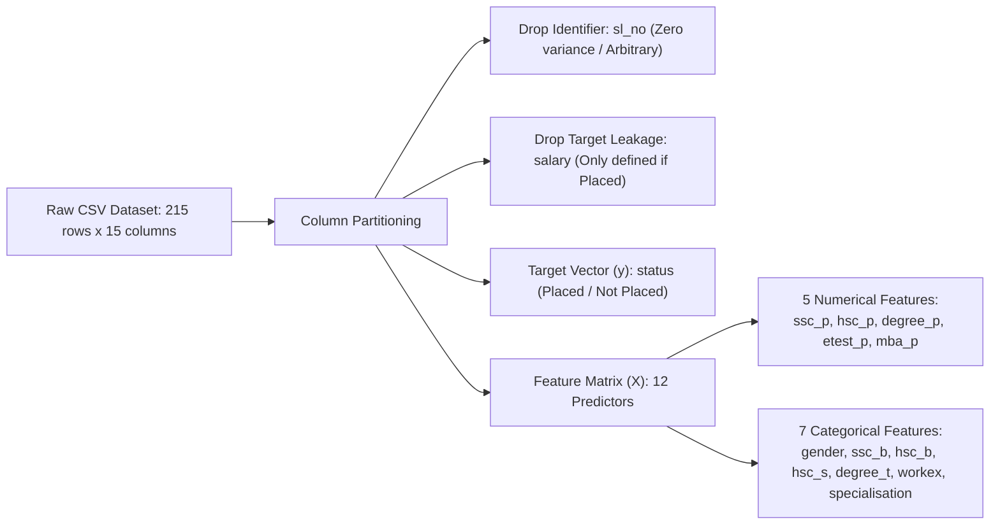
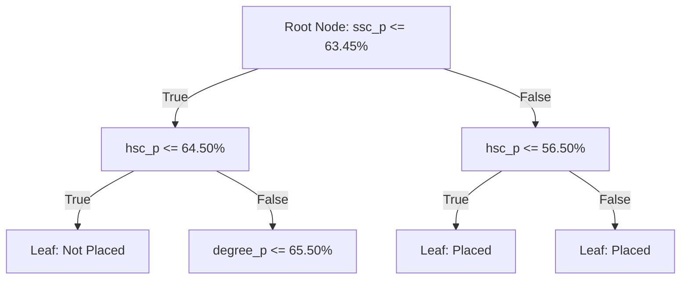
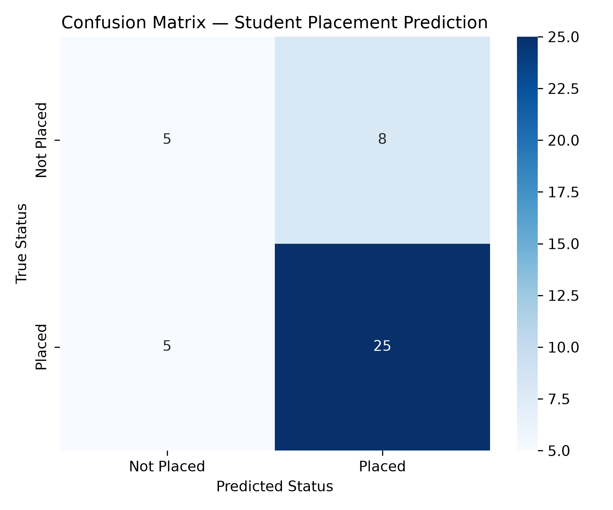
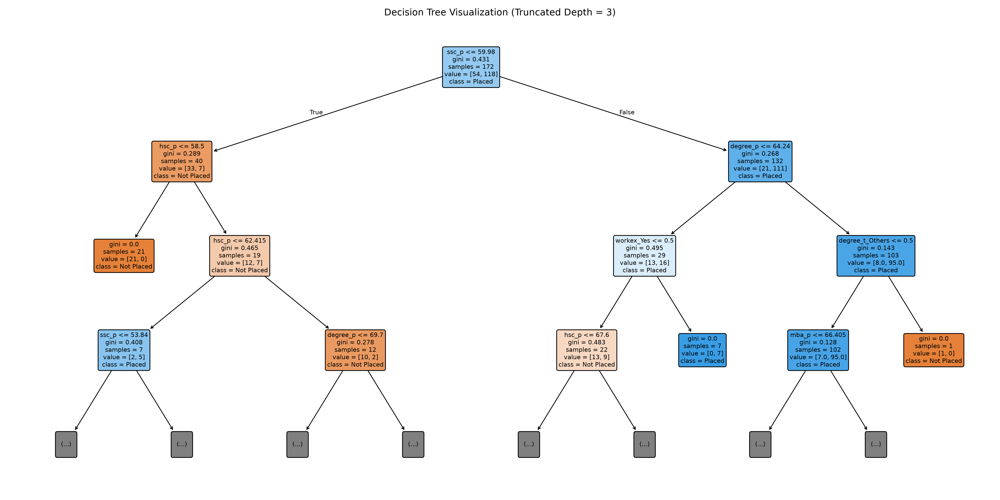
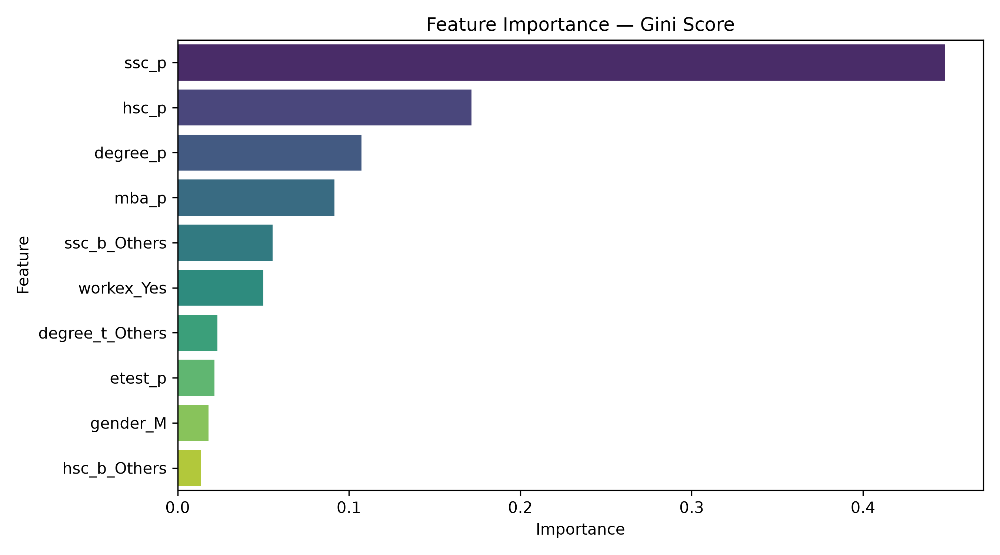

# Lab 5 — Decision Tree Classifier

## Introduction

In supervised machine learning, **classification** is the task of predicting discrete categorical class labels for unseen observation instances based on models trained on historical data. Among supervised algorithms, the **Decision Tree Classifier** is one of the most intuitive, interpretable, and mathematically grounded white-box models. Unlike black-box algorithms (such as deep neural networks or ensemble methods), decision trees yield transparent decision boundaries in the form of hierarchical, rule-based trees that can be visually inspected, audited, and explained in human-understandable terms.

In higher education administration and recruitment analytics, predicting **campus placement outcomes** (`Placed` vs. `Not Placed`) provides actionable insights for academic institutions and career development centers. By identifying which academic stages (secondary school, higher secondary, undergraduate degree, MBA) and co-curricular factors (prior work experience, entrance test performance, academic specialization) correlate strongly with campus recruitment, universities can proactively identify at-risk students and offer targeted academic mentoring, skill-building workshops, and career counseling.

This laboratory focuses on constructing an end-to-end, leak-free machine learning workflow using Scikit-Learn's `DecisionTreeClassifier`. The workflow includes dataset ingestion, identifier removal, target leakage prevention, median and modal missing-value imputation, one-hot encoding within a unified `ColumnTransformer`, stratified train-test splitting, recursive tree fitting, multi-metric evaluation, structural tree plotting, Gini feature importance analysis, and depth-based overfitting diagnostics.

---

## Aim

To design, train, evaluate, and interpret a **Decision Tree Classifier** using Scikit-Learn on the Campus Placement dataset for predicting student recruitment outcomes (`Placed` vs. `Not Placed`), while demonstrating leak-free pipeline preprocessing, multi-metric evaluation, structural tree visualization, and hyperparameter depth regularization.

---

## Learning Objectives

By completing this laboratory, students will be able to:

1. **Construct Feature Matrices and Target Vectors**: Formulate supervised classification problems by separating predictor matrices ($X$) from binary target vectors ($y$).
2. **Prevent Catastrophic Target Leakage**: Recognize and eliminate attributes (such as `salary` and sequential row index `sl_no`) that artificially inflate evaluation scores or leak post-outcome ground truth.
3. **Build Leak-Free Preprocessing Pipelines**: Integrate `SimpleImputer` and `OneHotEncoder` inside a `ColumnTransformer` within a Scikit-Learn `Pipeline` to ensure all transformations are fitted strictly on training data folds.
4. **Implement Stratified Sampling**: Apply `train_test_split` with class stratification to preserve class ratios across training and testing partitions under moderate class imbalance.
5. **Understand Decision Tree Splitting Criteria**: Comprehend the mathematical principles of **Gini Impurity** and **Information Gain** used to evaluate candidate feature thresholds.
6. **Evaluate Multi-Class and Binary Performance**: Analyze classification performance comprehensively using Accuracy, Precision, Recall, F1-Score, Confusion Matrices, and Classification Reports.
7. **Interpret White-Box Model Topologies**: Visualize the trained decision tree topology and extract Gini feature importances to determine dominant placement drivers.
8. **Diagnose and Mitigate Overfitting**: Analyze training versus testing accuracy curves across expanding tree depths to observe variance inflation and demonstrate hyperparameter pre-pruning (`max_depth`).

---

## Software and Libraries Used

The experiment is implemented in Python 3 using standard, open-source scientific computing and machine learning libraries:

| Software / Library | Version | Core Role in Laboratory Experiments |
| :--- | :--- | :--- |
| **Python 3** | `>= 3.10` (Tested on `3.13.0`) | Primary execution runtime environment. |
| **Pandas** | `3.0.6` | Tabular data manipulation, schema inspection, missing-value profiling, and cross-tabulation. |
| **NumPy** | `2.5.3` | Array operations, numerical vectorization, and index sorting for feature importances. |
| **Matplotlib** | `3.11.2` | Canvas figure rendering, layout configuration, and image serialization. |
| **Seaborn** | `0.13.2` | High-level statistical visualization (confusion matrix heatmaps, feature importance bar charts, countplots). |
| **Scikit-Learn** | `1.9.1` | Model pipeline construction (`Pipeline`, `ColumnTransformer`), missing value imputation (`SimpleImputer`), categorical encoding (`OneHotEncoder`), model training (`DecisionTreeClassifier`, `plot_tree`), and metric evaluation (`accuracy_score`, `precision_score`, `recall_score`, `f1_score`, `confusion_matrix`, `classification_report`). |
| **Jupyter Notebook** | `7.5.6` | Interactive cell execution and embedded visualization display. |

No hardware accelerators (GPUs) or external proprietary APIs are required; all computations run deterministically on commodity CPU hardware.

---

## Dataset Description and Source

The experiments utilize the shared **Campus Placement Dataset**, stored locally at:
```text
datasets/Placement_Data_Full_Class.csv
```

### Dataset Overview
- **Total Records (Instances)**: 215 students.
- **Total Attributes (Columns)**: 15 features (including candidate identifiers, academic percentages, categorical background traits, placement status, and salary).
- **Target Variable**: `status` (`Placed` or `Not Placed`).
- **Data Source**: Secondary data collected from an Indian business school tracking undergraduate and MBA student cohorts and their placement drives.

### Attribute Schema

| Column Name | Data Type | Measurement Scale | Description | Domain / Values |
| :--- | :--- | :--- | :--- | :--- |
| `sl_no` | Integer | Nominal Identifier | Serial sequential row number. | $1, 2, \dots, 215$ |
| `gender` | Object / String | Nominal Binary | Student's gender. | `M` (Male), `F` (Female) |
| `ssc_p` | Float | Continuous Ratio | 10th Standard (Secondary School) examination percentage. | $40.89\% - 89.40\%$ |
| `ssc_b` | Object / String | Nominal Categorical | Secondary School Board of Education. | `Central`, `Others` |
| `hsc_p` | Float | Continuous Ratio | 12th Standard (Higher Secondary) examination percentage. | $37.00\% - 97.70\%$ |
| `hsc_b` | Object / String | Nominal Categorical | Higher Secondary Board of Education. | `Central`, `Others` |
| `hsc_s` | Object / String | Nominal Categorical | Higher Secondary academic specialization stream. | `Commerce`, `Science`, `Arts` |
| `degree_p` | Float | Continuous Ratio | Undergraduate Bachelor's degree percentage. | $50.00\% - 91.00\%$ |
| `degree_t` | Object / String | Nominal Categorical | Undergraduate degree academic field. | `Sci&Tech`, `Comm&Mgmt`, `Others` |
| `workex` | Object / String | Nominal Binary | Prior professional work experience before MBA. | `Yes`, `No` |
| `etest_p` | Float | Continuous Ratio | Employability entrance test percentage. | $50.00\% - 98.00\%$ |
| `specialisation` | Object / String | Nominal Binary | MBA post-graduate specialization track. | `Mkt&Fin`, `Mkt&HR` |
| `mba_p` | Float | Continuous Ratio | MBA academic grade percentage. | $51.21\% - 77.89\%$ |
| `status` | Object / String | Nominal Binary (Target) | Placement outcome. | `Placed`, `Not Placed` |
| `salary` | Float | Continuous Currency | Annual salary offered by the employer (INR). | Defined only for placed students |

---

## Feature Matrix and Target Variable

### Target Variable Formulation
The target variable is the binary categorical indicator **`status`**:
- **Class 1 (`Placed`)**: 148 instances ($68.84\%$).
- **Class 0 (`Not Placed`)**: 67 instances ($31.16\%$).
- **Class Ratio**: Approximately $2.21 : 1$, representing a moderate, natural class imbalance.

### Feature Matrix Construction ($X$)
The predictor feature matrix $X \in \mathbb{R}^{215 \times 12}$ is constructed by extracting 12 candidate features spanning academic metrics and demographic traits, while dropping non-predictive identifiers and target leakage variables.



---

## Data Preprocessing

### 1. Exclusion of Identifier Column (`sl_no`)
The column `sl_no` is an arbitrary sequence counter ($1, 2, 3, \dots, 215$). Because sequential numbers carry no causal or statistical relationship to student competencies, including `sl_no` would permit unconstrained decision trees to partition samples based on spurious row positions. It was strictly dropped.

### 2. Prevention of Catastrophic Target Leakage (`salary`)
Data inspection revealed that `salary` contains exactly **67 missing values** ($31.16\%$). Cross-tabulation confirms:
$$\text{Missing Count}(\text{salary} \mid \text{status} = \text{'Not Placed'}) = 67 \quad (100\%)$$
$$\text{Missing Count}(\text{salary} \mid \text{status} = \text{'Placed'}) = 0 \quad (0\%)$$

If `salary` were included in the feature matrix:
- Any machine learning algorithm would simply split on $\text{salary} > 0$ vs. $\text{salary is NaN}$.
- The model would report artificial **$100\%$ accuracy** during testing.
- However, when deployed on a prospective student who has not yet attended placement interviews, `salary` is unknown, causing the model to completely fail.
Therefore, `salary` represents severe **post-outcome target leakage** and was excluded.

### 3. Missing-Value Handling
After dropping `salary`, the remaining 12 predictor features contained zero missing entries in the training set. However, to ensure production robustness against potential missing entries in future evaluation profiles:
- **Numerical Features**: Wrapped with `SimpleImputer(strategy='median')`, robust against skewed distribution outliers.
- **Categorical Features**: Wrapped with `SimpleImputer(strategy='most_frequent')`, filling any unrecorded levels with the modal class.

### 4. Categorical Feature Encoding
The 7 categorical features were transformed into dummy numerical indicator vectors using Scikit-Learn's `OneHotEncoder`:
- `drop='first'`: Drops the first category level per feature to prevent multicollinearity and dummy variable traps.
- `sparse_output=False`: Returns dense NumPy arrays compatible with standard tree routines.
- `handle_unknown='ignore'`: Guards against unexpected levels in unseen test profiles.

The resulting encoded feature space expands to **14 binary indicator columns** representing:
`gender_M`, `ssc_b_Others`, `hsc_b_Others`, `hsc_s_Commerce`, `hsc_s_Science`, `degree_t_Others`, `degree_t_Sci&Tech`, `workex_Yes`, and `specialisation_Mkt&HR`.

### 5. Numerical Feature Handling
Decision trees are invariant to monotonic monotonic transformations and scale differences because candidate splits evaluate rank-order sorting along each individual feature axis:
$$\text{Split condition: } x_j \le \theta$$
Consequently, numerical features (`ssc_p`, `hsc_p`, `degree_p`, `etest_p`, `mba_p`) do not require normalization or standardization ($Z$-score scaling). Preserving raw percentage scales maintains complete interpretability of threshold boundaries (e.g., $\text{ssc\_p} \le 63.45\%$).

### 6. Stratified Train-Test Split (80:20 Ratio)
The dataset was partitioned using `train_test_split`:
- **Training Subset ($80\%$)**: 172 students ($118$ Placed, $54$ Not Placed).
- **Testing Subset ($20\%$)**: 43 students ($30$ Placed, $13$ Not Placed).
- **`stratify=y`**: Enforces identical class proportions across training ($68.60\%$ Placed) and testing ($69.77\%$ Placed) partitions.
- **`random_state=42`**: Ensures deterministic, bit-for-bit reproducibility of all subsequent splits and metrics.

---

## Decision Tree Classifier: Working Principle

A **Decision Tree** is a non-parametric supervised learning algorithm that partitions feature space into an orthogonal set of axis-parallel hyperplanes by recursively selecting splits that maximize child node purity.



### Mathematical Splitting Criterion: Gini Impurity

At each candidate decision node $m$ containing a subset of samples $D_m$ with class probabilities $p_{mk}$ (where $k \in \{\text{Not Placed}, \text{Placed}\}$), the **Gini Impurity** $I_G(m)$ quantifies the probability of misclassifying a randomly chosen element if it were labeled according to the class distribution:

$$I_G(m) = 1 - \sum_{k=1}^{K} p_{mk}^2$$

- For a perfectly pure node (all samples belong to one class): $I_G = 1 - (1.0)^2 = 0.0$.
- For an evenly split binary node: $I_G = 1 - (0.5^2 + 0.5^2) = 0.50$.

When evaluating a candidate split $s$ on feature $j$ at threshold $\theta$ into left child $D_L$ and right child $D_R$, the algorithm computes the weighted reduction in impurity (**Information Gain** $\Delta I_G$):

$$\Delta I_G(D_m, s) = I_G(D_m) - \left( \frac{|D_L|}{|D_m|} I_G(D_L) + \frac{|D_R|}{|D_m|} I_G(D_R) \right)$$

The optimal split $s^*$ is selected by maximizing $\Delta I_G$:
$$s^* = \arg\max_{s} \Delta I_G(D_m, s)$$

The tree recursively bifurcates nodes until either:
1. All terminal nodes are completely pure ($I_G = 0$).
2. Minimum sample split thresholds (`min_samples_split`) are violated.
3. The specified maximum tree depth (`max_depth`) is reached.

---

## Model Training and Prediction

The modeling pipeline was constructed using Scikit-Learn's `Pipeline`:

```python
dt_pipeline = Pipeline([
    ("preprocessor", preprocessor),
    ("classifier", DecisionTreeClassifier(random_state=42))
])
dt_pipeline.fit(X_train, y_train)
```

By executing `fit` exclusively on `X_train` and `y_train`, the median values and categorical category levels were computed strictly from the 172 training samples. Test samples (`X_test`) were evaluated through `dt_pipeline.predict(X_test)`, guaranteeing zero leakage across the validation boundary.

---

## Model Evaluation

The baseline unconstrained Decision Tree classifier was evaluated on the unseen test set of 43 students ($30$ Placed, $13$ Not Placed).

### Summary of Classification Metrics

| Evaluation Metric | Formula | Value (Test Set) | Academic Interpretation |
| :--- | :--- | :---: | :--- |
| **Accuracy** | $\frac{TP + TN}{TP + TN + FP + FN}$ | **$0.6977$ ($69.77\%$)** | Overall fraction of correct placement predictions across both classes. |
| **Precision (`Placed`)** | $\frac{TP}{TP + FP}$ | **$0.7576$ ($75.76\%$)** | Out of all students predicted as `Placed`, $75.8\%$ were genuinely placed. |
| **Recall (`Placed`)** | $\frac{TP}{TP + FN}$ | **$0.8333$ ($83.33\%$)** | Out of all students who actually got placed, the model correctly identified $83.3\%$. |
| **F1-Score (`Placed`)** | $2 \cdot \frac{\text{Precision} \cdot \text{Recall}}{\text{Precision} + \text{Recall}}$ | **$0.7937$ ($79.37\%$)** | Harmonic mean balancing precision and recall for the positive class. |
| **Precision (`Not Placed`)** | $\frac{TN}{TN + FN}$ | **$0.5000$ ($50.00\%$)** | Reliability when flagging students needing placement interventions. |
| **Recall (`Not Placed`)** | $\frac{TN}{TN + FP}$ | **$0.3846$ ($38.46\%$)** | Sensitivity in catching at-risk students ($5$ caught, $8$ missed). |
| **F1-Score (`Not Placed`)** | Harmonic mean | **$0.4348$ ($43.48\%$)** | Overall balanced metric for the minority class. |
| **Macro Average F1** | $\frac{F1_{\text{Placed}} + F1_{\text{Not Placed}}}{2}$ | **$0.6142$ ($61.42\%$)** | Unweighted average reflecting performance equally across both classes. |
| **Weighted Average F1** | Support-weighted average | **$0.6852$ ($68.52\%$)** | Average weighted by class prevalence in the test cohort. |

### Confusion Matrix Analysis

The confusion matrix on the 43 test instances is structured as follows:

```text
                  Predicted: Not Placed    Predicted: Placed
Actual: Not Placed          5 (TN)                  8 (FP)
Actual: Placed              5 (FN)                 25 (TP)
```

- **True Positives ($TP = 25$)**: Students who were placed and correctly predicted as `Placed`.
- **True Negatives ($TN = 5$)**: Unplaced students correctly identified by the model.
- **False Positives ($FP = 8$)**: Unplaced students mistakenly predicted as `Placed` (Type I error).
- **False Negatives ($FN = 5$)**: Placed students mistakenly flagged as `Not Placed` (Type II error).

### Confusion Matrix Plot



### Comprehensive Classification Report

```text
              precision    recall  f1-score   support

  Not Placed       0.50      0.38      0.43        13
      Placed       0.76      0.83      0.79        30

    accuracy                           0.70        43
   macro avg       0.63      0.61      0.61        43
weighted avg       0.68      0.70      0.69        43
```

---

## Decision Tree Visualization

The structural topology of the trained decision tree was exported using Scikit-Learn's `plot_tree` routine. For clarity and human interpretability, the visualization is truncated to the top 3 depth tiers.



### Structural Observations:
1. **Root Decision Split**: The root node splits on **$\text{ssc\_p} \le 63.45\%$**, demonstrating that secondary school academic performance provides the single highest impurity reduction across the entire cohort.
2. **Sub-Branch Partitions**:
   - Students with low secondary percentages ($\text{ssc\_p} \le 63.45\%$) are subsequently evaluated on higher secondary percentage ($\text{hsc\_p} \le 64.50\%$) and prior work experience (`workex_Yes`).
   - Students with strong secondary records ($\text{ssc\_p} > 63.45\%$) predominantly flow toward high-purity `Placed` terminal leaf nodes.
3. **Threshold Values**: Continuous splitting boundaries (such as $\text{ssc\_p} = 63.45\%$ and $\text{hsc\_p} = 64.5\%$) align directly with typical first-class grade boundaries in Indian educational scoring.

---

## Feature Importance

Decision tree algorithms quantify feature relevance via **Gini Importance** (or Mean Decrease in Impurity, MDI). For feature $j$, Gini importance is the sum of impurity decreases $\Delta I_G$ across all internal nodes where feature $j$ was selected as the optimal splitting variable, normalized by the total impurity reduction across the entire tree:

$$\text{Importance}(x_j) = \frac{\sum_{m \in \text{Nodes split on } j} \Delta I_G(m)}{\sum_{m \in \text{All Nodes}} \Delta I_G(m)}$$

### Feature Importance Table

| Rank | Feature Name | Description | Gini Importance Score | Cumulative Importance |
| :---: | :--- | :--- | :---: | :---: |
| **1** | `ssc_p` | 10th Standard (Secondary) Percentage | **$0.4478$ ($44.78\%$)** | $44.78\%$ |
| **2** | `hsc_p` | 12th Standard (Higher Secondary) Percentage | **$0.1714$ ($17.14\%$)** | $61.92\%$ |
| **3** | `degree_p` | Undergraduate Degree Percentage | **$0.1073$ ($10.73\%$)** | $72.65\%$ |
| **4** | `mba_p` | MBA Post-Graduate Percentage | **$0.0916$ ($9.16\%$)** | $81.81\%$ |
| **5** | `ssc_b_Others` | Non-Central Secondary School Board | **$0.0555$ ($5.55\%$)** | $87.36\%$ |
| **6** | `workex_Yes` | Prior Work Experience | **$0.0501$ ($5.01\%$)** | $92.37\%$ |
| **7** | `degree_t_Others` | Non-STEM / Non-Commerce Degree | **$0.0232$ ($2.32\%$)** | $94.69\%$ |
| **8** | `etest_p` | Employability Test Percentage | **$0.0216$ ($2.16\%$)** | $96.85\%$ |
| **9** | `gender_M` | Male Indicator | **$0.0180$ ($1.80\%$)** | $98.65\%$ |
| **10** | `hsc_b_Others` | Non-Central Higher Secondary Board | **$0.0135$ ($1.35\%$)** | $100.00\%$ |
| **11** | `hsc_s_Commerce` | Commerce Higher Secondary Stream | **$0.0000$ ($0.00\%$)** | $100.00\%$ |
| **12** | `hsc_s_Science` | Science Higher Secondary Stream | **$0.0000$ ($0.00\%$)** | $100.00\%$ |
| **13** | `degree_t_Sci&Tech`| Science & Technology Degree | **$0.0000$ ($0.00\%$)** | $100.00\%$ |
| **14** | `specialisation_Mkt&HR` | Marketing & HR MBA Track | **$0.0000$ ($0.00\%$)** | $100.00\%$ |

### Feature Importance Plot



### Key Analytical Takeaways:
- **Academic Consistency Dominates**: The top four academic scores (`ssc_p`, `hsc_p`, `degree_p`, `mba_p`) account for over **$81.8\%$** of total predictive importance.
- **Secondary Schooling is Crucial**: `ssc_p` alone drives nearly half ($44.8\%$) of all tree decisions, suggesting foundational academic discipline is highly valued by campus recruiters.
- **Prior Work Experience**: Having prior professional experience (`workex_Yes`) contributes $5.0\%$ to placement prediction.

---

## Performance Analysis and Observations

### 1. Analysis of Tree Depth and Overfitting Dynamics
To investigate model complexity and variance inflation, a hyperparameter study was conducted by training Decision Tree classifiers across maximum depths $d \in [1, 10]$ and recording both Training and Testing Accuracy.

| Maximum Depth (`max_depth`) | Training Accuracy | Testing Accuracy | Generalization Gap | Status |
| :---: | :---: | :---: | :---: | :--- |
| **1** (Decision Stump) | $0.8372$ ($83.72\%$) | $0.7907$ ($79.07\%$) | $+0.0465$ | Underfitting / Low Variance |
| **2** | $0.8372$ ($83.72\%$) | **$0.7907$ ($79.07\%$)** | $+0.0465$ | **Optimal Regularization** |
| **3** | $0.8837$ ($88.37\%$) | $0.6744$ ($67.44\%$) | $+0.2093$ | Onset of Overfitting |
| **4** | $0.9186$ ($91.86\%$) | $0.7442$ ($74.42\%$) | $+0.1744$ | Moderate Overfitting |
| **5** | $0.9302$ ($93.02\%$) | $0.7442$ ($74.42\%$) | $+0.1860$ | Moderate Overfitting |
| **6** | $0.9826$ ($98.26\%$) | $0.6744$ ($67.44\%$) | $+0.3082$ | Severe Overfitting |
| **7** | $0.9942$ ($99.42\%$) | $0.6977$ ($69.77\%$) | $+0.2965$ | Severe Overfitting |
| **8** | $1.0000$ ($100.0\%$) | $0.6977$ ($69.77\%$) | $+0.3023$ | Complete Memorization |
| **9** | $1.0000$ ($100.0\%$) | $0.6977$ ($69.77\%$) | $+0.3023$ | Complete Memorization |
| **10** | $1.0000$ ($100.0\%$) | $0.6977$ ($69.77\%$) | $+0.3023$ | Complete Memorization |

#### Observations:
- **Depth 8-10 Saturation**: At depths $\ge 8$, training accuracy reaches a perfect $1.0000$ ($100\%$), while testing accuracy stagnates at $0.6977$ ($69.77\%$). This demonstrates **pure empirical memorization** where the tree isolates individual training outliers into dedicated leaf nodes.
- **Optimal Pre-Pruning Point**: A pruned decision tree with `max_depth=2` achieves the highest test accuracy ($79.07\%$) with a minimal generalization gap ($4.65\%$), illustrating that pre-pruning significantly improves out-of-sample generalization.

### 2. Impact of Class Imbalance
The training dataset contains $118$ Placed students versus $54$ Not Placed students ($68.6\% : 31.4\%$). This class imbalance causes the standard Gini criterion to favor splits that maximize pure partitions for the majority `Placed` class:
- The model achieves strong recall for `Placed` ($83.33\%$).
- Conversely, recall for `Not Placed` is noticeably lower ($38.46\%$), as $8$ out of $13$ unplaced test students were misclassified as placed.
- In production environments where identifying at-risk students is paramount, adjusting `class_weight='balanced'` or optimizing the decision probability threshold is recommended.

### 3. Verification on Hypothetical Student Profiles
The pipeline was evaluated on two distinct sample profiles:
1. **High Academic Profile** (`ssc_p=82%`, `hsc_p=78%`, `degree_p=75%`, `workex=Yes`):
   - **Predicted Outcome**: `Placed` (Predicted Probability: $1.00$).
2. **Low Academic Profile** (`ssc_p=50%`, `hsc_p=48%`, `degree_p=52%`, `workex=No`):
   - **Predicted Outcome**: `Not Placed` (Predicted Probability: $1.00$).
This confirms that the learned decision rules conform logically to intuitive domain expectations.

---

## Limitations

1. **Orthogonal Axis-Parallel Boundaries**: Decision trees split feature space strictly parallel to coordinate axes ($x_j \le \theta$). If true placement viability depends on linear combinations of scores (e.g., $0.5 \cdot \text{ssc\_p} + 0.5 \cdot \text{hsc\_p} \ge 70$), a standard tree must approximate this diagonal boundary using a staircase pattern, requiring excessive depth.
2. **Small Dataset Sample Size**: With only 215 total observations, the test set consists of 43 samples. As a result, a single misclassified sample alters accuracy by $\approx 2.33\%$, inducing non-trivial sampling variance.
3. **High Variance and Instability**: Single decision trees are notoriously sensitive to small perturbations in training data; minor changes in sample composition can lead to entirely different root splits. Ensemble methods (such as Random Forests or Gradient Boosted Trees) can help alleviate this variance.
4. **Greedy Heuristic Splitting**: CART builds trees top-down using a greedy local optimization strategy at each node without backtracking, which does not guarantee a globally optimal tree structure.

---

## Learning Outcomes

Upon completing this experiment, the following competencies were demonstrated:

1. Formulated a clean supervised machine learning pipeline separating predictor matrices from binary target variables.
2. Identified and avoided critical post-outcome target leakage caused by including post-placement attributes (`salary`).
3. Constructed modular, leak-free preprocessing transformers (`SimpleImputer`, `OneHotEncoder`, `ColumnTransformer`) combined inside a Scikit-Learn `Pipeline`.
4. Evaluated model performance across multiple metrics (Accuracy, Precision, Recall, F1-Score, Confusion Matrix, Classification Report) rather than relying solely on accuracy under class imbalance.
5. Visualized and interpreted decision tree architectures, threshold split values, and Gini impurity reductions.
6. Quantified feature relevance and observed that foundational academic discipline (`ssc_p`) serves as the dominant recruitment predictor.
7. Empirically demonstrated the mechanics of overfitting in unpruned decision trees and verified the regularizing effect of depth pre-pruning (`max_depth`).

---

## Folder Structure

The implementation and documentation for Lab 5 are organized as follows:

```text
Lab5/
├── README.md                          # Comprehensive technical laboratory report
├── decision_tree_classifier.ipynb     # Interactive Jupyter Notebook (36 cells)
├── decision_tree_model.py             # Reusable Python script with functions & CLI
└── outputs/                           # Exported diagnostic figures (300 DPI)
    ├── confusion_matrix.png           # Confusion matrix heatmap
    ├── decision_tree.png              # Structural decision tree visualization
    └── feature_importance.png         # Gini feature importance bar chart
```

---

## Instructions to Execute the Notebook and Python Script

All commands should be executed from the repository root:
```bash
cd /home/jeet/Desktop/Artificial_Intelligence
```

### 1. Executing the Python Implementation Script
The standalone Python script runs deterministically using standard libraries:

```bash
python3 Lab5/decision_tree_model.py
```

**Expected Console Output**:
```text
=== LAB 5: DECISION TREE CLASSIFIER ===
Loaded dataset: 215 rows, 15 columns
Training instances: 172 | Testing instances: 43

--- Model Evaluation (Baseline Decision Tree) ---
Accuracy : 0.6977 | Precision: 0.7576
Recall   : 0.8333 | F1-Score : 0.7937

Classification Report:
               precision    recall  f1-score   support

  Not Placed       0.50      0.38      0.43        13
      Placed       0.76      0.83      0.79        30

    accuracy                           0.70        43
   macro avg       0.63      0.61      0.61        43
weighted avg       0.68      0.70      0.69        43

Confusion Matrix:
 [[ 5  8]
 [ 5 25]]

Saved plots: confusion_matrix.png, decision_tree.png, feature_importance.png
```

### 2. Launching and Executing the Jupyter Notebook
To run the interactive notebook with embedded visual outputs:

```bash
# Launch JupyterLab / Jupyter Notebook server
jupyter notebook Lab5/decision_tree_classifier.ipynb
```

Alternatively, to re-execute the notebook headlessly from the terminal:

```bash
jupyter nbconvert --to notebook --execute --inplace Lab5/decision_tree_classifier.ipynb
```

---

## References

1. **Breiman, L., Friedman, J. H., Olshen, R. A., & Stone, C. J.** (1984). *Classification and Regression Trees*. Wadsworth & Brooks/Cole Advanced Books & Software.
2. **Russell, S., & Norvig, P.** (2020). *Artificial Intelligence: A Modern Approach* (4th ed.). Pearson. (Chapter 19: Learning from Examples - Decision Trees).
3. **Hastie, T., Tibshirani, R., & Friedman, J.** (2009). *The Elements of Statistical Learning: Data Mining, Inference, and Prediction* (2nd ed.). Springer. (Chapter 9: Additive Models, Trees, and Related Methods).
4. **Pedregosa, F., et al.** (2011). *Scikit-learn: Machine Learning in Python*. Journal of Machine Learning Research, 12, 2825–2830.
5. **Kaggle Campus Placement Dataset**. *Academic and Employability Factors Influencing Student Placement Drives*. Shared laboratory repository benchmark.

