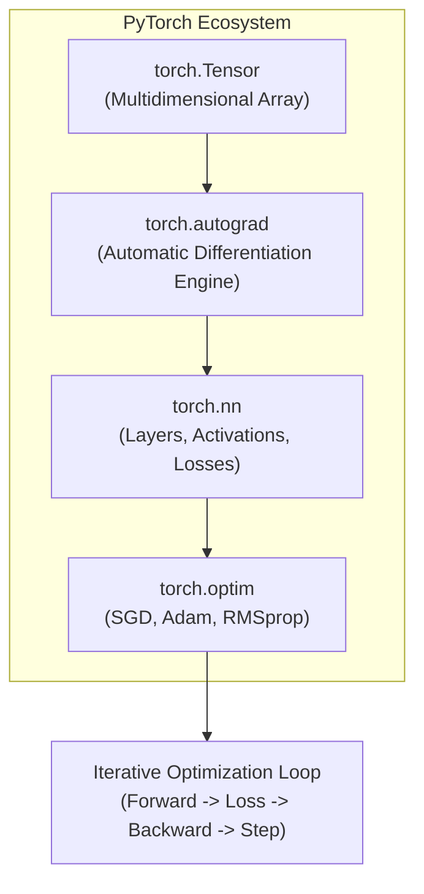
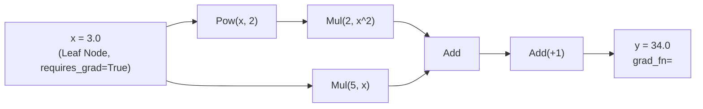
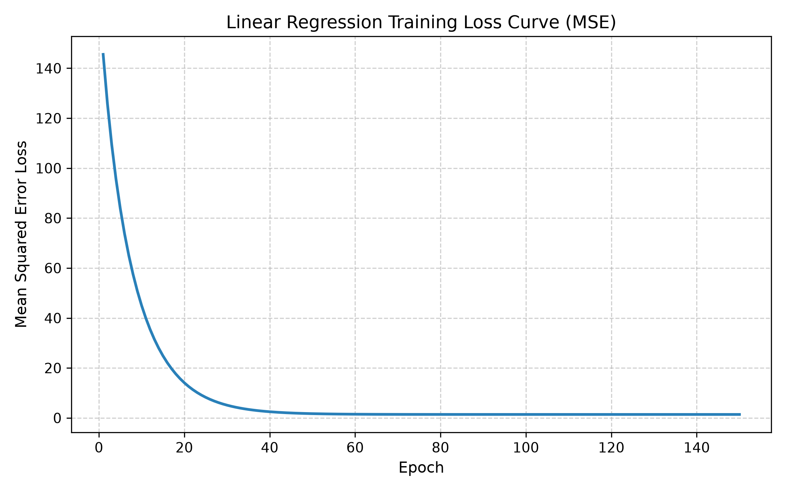
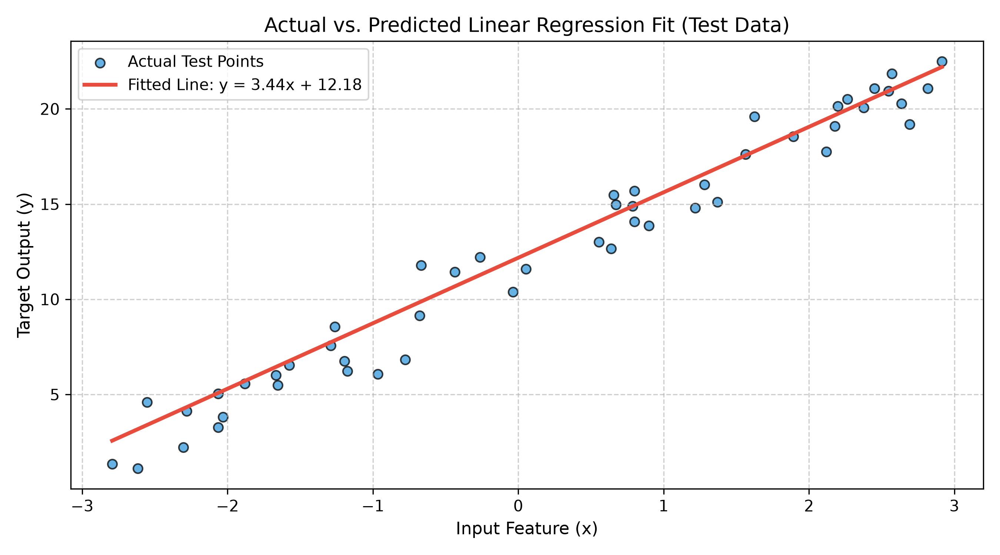
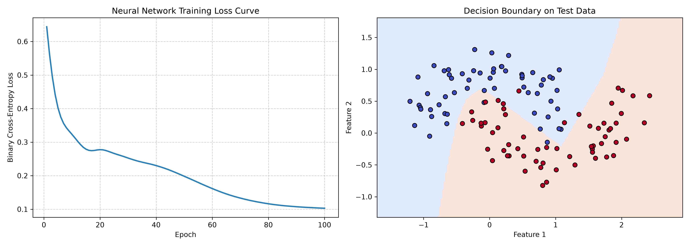

# Lab 6 — Deep Learning using PyTorch

## Introduction

In Artificial Intelligence and Deep Learning, computational models have evolved from hand-crafted statistical rules and shallow estimators to multi-layered artificial neural networks capable of learning hierarchical representations directly from data. At the core of modern deep learning lies the concept of **differentiable programming**—the ability to represent computational workflows as directed acyclic graphs (DAGs) and optimize millions of continuous parameters via gradient-based optimization algorithms.

**PyTorch**, developed by Meta AI and maintained as an open-source Linux Foundation project, has emerged as the premier research and production framework for deep learning. PyTorch combines the intuitive, idiomatic syntax of Python and NumPy with two foundational capabilities:
1. **GPU- and CPU-Accelerated Tensor Computation**: High-performance $n$-dimensional array operations optimized with low-level C++ and BLAS backends.
2. **Dynamic Automatic Differentiation (Tape-Based Autograd)**: A computational engine that dynamically tracks operations on tensors as they occur in memory and computes exact derivatives via reverse-mode automatic differentiation.

This laboratory provides an end-to-end, hands-on introduction to deep learning engineering in PyTorch. The experiments progress systematically from foundational tensor algebra and autograd computational graph inspection, to parametric optimization using a single-layer Linear Regression model, and finally to non-linear pattern recognition with a Multi-Layer Perceptron (MLP) classification network.

---

## Aim

To study, implement, and evaluate deep learning fundamentals using **PyTorch**, covering multidimensional tensor operations, automatic differentiation (`torch.autograd`), parametric model construction (`torch.nn`), loss formulation (`torch.nn.MSELoss`, `torch.nn.BCEWithLogitsLoss`), gradient-based optimization (`torch.optim.SGD`, `torch.optim.Adam`), and empirical model evaluation across regression and classification tasks.

---

## Learning Objectives

By completing this laboratory, students will be able to:

1. **Manipulate Multidimensional Tensors**: Create, index, slice, reshape (`view`), and transpose PyTorch tensors, understanding memory layouts and shared buffers with NumPy.
2. **Execute Linear Algebraic Tensor Operations**: Perform vectorized element-wise arithmetic, dot products, and matrix multiplications using `torch.matmul` and the `@` operator.
3. **Understand Dynamic Computational Graphs**: Trace forward-pass operations in memory, inspect `grad_fn` backward nodes, and grasp the Directed Acyclic Graph (DAG) abstraction.
4. **Master Autograd & Gradient Propagation**: Track variables with `requires_grad=True`, trigger backward passes via `.backward()`, and inspect analytical parameter gradients (`.grad`).
5. **Construct Parametric PyTorch Models**: Subclass `torch.nn.Module` to define modular neural network layers and forward propagation logic.
6. **Formulate Loss Functions & Optimizers**: Implement Mean Squared Error (MSE) and Binary Cross-Entropy (BCE) loss functions, and optimize parameters using Stochastic Gradient Descent (SGD) and Adam.
7. **Implement the Canonical Training Loop**: Execute the 5-step optimization lifecycle: forward pass $\to$ loss evaluation $\to$ gradient clearing (`zero_grad`) $\to$ backpropagation (`backward`) $\to$ parameter update (`step`).
8. **Evaluate and Visualize Deep Learning Models**: Assess regression ($R^2$, RMSE) and classification (Accuracy, Precision, Recall, F1-Score) performance, visualizing loss curves, regression fits, and non-linear decision boundaries.

---

## Software and Libraries Used

All laboratory implementations are developed in Python 3 and execute entirely on standard CPU hardware without requiring dedicated GPUs:

| Software / Library | Version | Role in Laboratory Experiments |
| :--- | :--- | :--- |
| **Python 3** | `>= 3.10` (Tested on `3.13.0`) | Primary programming runtime. |
| **PyTorch (`torch`)** | `2.15.0+cpu` | Core deep learning framework providing tensors, autograd, `torch.nn`, and `torch.optim`. |
| **NumPy** | `2.5.3` | Synthetic dataset generation, array manipulation, and memory interoperability with PyTorch. |
| **Pandas** | `3.0.6` | Tabular alignment of actual vs. predicted values and residual analysis. |
| **Matplotlib** | `3.11.2` | Rendering training loss curves, regression fit plots, and decision boundary contours. |
| **Scikit-Learn** | `1.9.1` | Train-test splitting (`train_test_split`), dataset generation (`make_moons`), and evaluation metrics (`r2_score`, `mean_squared_error`, `accuracy_score`, `classification_report`, `confusion_matrix`). |
| **Jupyter Notebook** | `7.5.6` | Interactive cell execution and embedded visualization rendering. |

---

## Introduction to PyTorch

### What is PyTorch?
PyTorch is a machine learning framework designed around three core principles:
- **Eager Execution (Define-by-Run)**: Unlike static graph frameworks (such as early TensorFlow), PyTorch builds computational graphs dynamically on the fly during the forward pass. Every line of Python code executes immediately, making code debugging, Python control flow (loops, conditionals), and variable inspection seamless.
- **Tensors as First-Class Citizens**: Tensors are generalized $n$-dimensional geometric objects that behave like NumPy arrays but support asynchronous hardware execution and automated gradient computation.
- **Modular Object-Oriented Architecture**: Neural network architectures are encapsulated cleanly in `torch.nn.Module`, separating architecture design, forward computation, parameter management, and loss evaluation into decoupled modules.



---

## Experiment 1: PyTorch Basics

### 1. Tensor Creation and Manipulation
Tensors can be instantiated directly from native Python collections, shared NumPy arrays, or specialized initialization functions:
- `torch.tensor([10., 20., 30., 40.])`: Allocates a 1D tensor from a list.
- `torch.from_numpy(np_array)`: Zero-copy instantiation sharing the underlying memory buffer with NumPy.
- `torch.zeros((2, 3))`, `torch.ones((2, 3))`: Constant initialization.
- `torch.randn(3, 4)`: Random sampling from a standard normal distribution $\mathcal{N}(0, 1)$.

Every tensor maintains metadata attributes:
- `shape` (`torch.Size([3, 4])`): Spatial extent along each axis.
- `ndim` ($2$): Tensor rank.
- `dtype` (`torch.float32`, `torch.int64`): Precision and memory allocation.
- `device` (`cpu`): Physical hardware location.

### 2. Tensor Operations
PyTorch supports comprehensive tensor manipulation:
- **Indexing & Slicing**: Identical to NumPy (`matrix[0, :]`, `matrix[:, 2]`, `matrix[0:2, 1:3]`).
- **Reshaping**: `matrix.view(2, 6)` reorganizes elements without copying memory, while `t()` transposes 2D matrices ($3 \times 4 \to 4 \times 3$).
- **Element-wise Arithmetic**: Vectorized addition ($A + B$), subtraction ($A - B$), and Hadamard product ($A \odot B$).
- **Matrix Multiplication**: Formally computed via `torch.matmul(A, B)` or the `@` operator:
  $$\begin{bmatrix} 1 & 2 \\ 3 & 4 \end{bmatrix} \begin{bmatrix} 5 & 6 \\ 7 & 8 \end{bmatrix} = \begin{bmatrix} 1(5)+2(7) & 1(6)+2(8) \\ 3(5)+4(7) & 3(6)+4(8) \end{bmatrix} = \begin{bmatrix} 19 & 22 \\ 43 & 50 \end{bmatrix}$$

### 3. Computational Graphs and Autograd
When a tensor is declared with `requires_grad=True`, PyTorch treats it as a leaf node in a dynamic computational graph. As downstream mathematical operations are executed, each operation generates a `grad_fn` node recording the exact backward derivative formula:



### 4. Gradient Computation via `.backward()`
Given the quadratic scalar function:
$$y = 2x^2 + 5x + 1$$
Analytical differentiation with respect to $x$ yields:
$$\frac{dy}{dx} = 4x + 5$$
Evaluating at $x = 3.0$:
$$\frac{dy}{dx}\Big|_{x=3} = 4(3) + 5 = 17.0$$

Executing `y.backward()` traverses the computational graph in reverse using the chain rule, populating `x.grad` with the exact computed gradient:
```text
Autograd computed x.grad: 17.0000
Analytical derivative    : 17.0000
```
When gradient computation is unnecessary (such as during inference or evaluation), wrapping code blocks inside `with torch.no_grad():` disables graph construction, conserving computational memory and runtime overhead.

---

## Experiment 2: Linear Regression using PyTorch

### 1. Dataset Generation
A reproducible synthetic dataset of $N=250$ samples was generated based on the linear relation:
$$y = W_{\text{true}} \cdot x + b_{\text{true}} + \epsilon$$
- **True Weight ($W$)**: $3.5$
- **True Bias ($b$)**: $12.0$
- **Input Feature ($x$)**: Sampled uniformly from $x \in [-3.0, 3.0]$.
- **Gaussian Noise ($\epsilon$)**: Zero-mean perturbation $\epsilon \sim \mathcal{N}(0, 1.2^2)$ simulating real-world measurement error.

The data was converted into 2D PyTorch float tensors of shape `(250, 1)` and partitioned using an 80:20 ratio:
- **Training Set**: 200 samples ($80\%$).
- **Testing Set**: 50 samples ($20\%$).

### 2. Model Architecture
The linear regression model was constructed by subclassing `torch.nn.Module`:

```python
class LinearRegressionModel(nn.Module):
    def __init__(self):
        super().__init__()
        self.linear = nn.Linear(in_features=1, out_features=1)

    def forward(self, x: torch.Tensor) -> torch.Tensor:
        return self.linear(x)
```
The layer `nn.Linear(1, 1)` maintains two learnable parameters:
$$\hat{y} = x \cdot W + b$$
Both $W$ and $b$ were initialized with random values before training.

### 3. Loss Function and Optimizer
- **Loss Function (`nn.MSELoss`)**: Mean Squared Error quantifies the mean squared distance between model predictions and target targets:
  $$\text{MSE}(\hat{y}, y) = \frac{1}{N} \sum_{i=1}^{N} (\hat{y}_i - y_i)^2$$
- **Optimizer (`optim.SGD`)**: Stochastic Gradient Descent updates parameters in the direction opposite to the loss gradient:
  $$W \leftarrow W - \eta \frac{\partial \mathcal{L}}{\partial W}, \quad b \leftarrow b - \eta \frac{\partial \mathcal{L}}{\partial b}$$
  A learning rate of $\eta = 0.03$ was selected to ensure stable convergence without oscillatory divergence.

### 4. Training Loop
The training loop was executed across **150 epochs**. In each epoch, the five canonical steps were performed:
1. `model.train()`: Configures the model in training mode.
2. `predictions = model(X_train)`: Computes forward predictions.
3. `loss = criterion(predictions, y_train)`: Computes empirical MSE loss.
4. `optimizer.zero_grad()`: Flushes accumulated gradients from the previous iteration.
5. `loss.backward()`: Computes $\nabla_W \mathcal{L}$ and $\nabla_b \mathcal{L}$ via reverse-mode autograd.
6. `optimizer.step()`: Updates $W$ and $b$ using the SGD rule.

### 5. Testing and Evaluation
Model parameters converged smoothly over the 150 epochs:
- **Initial Training Loss (Epoch 1)**: $145.5373$
- **Final Training Loss (Epoch 150)**: $1.3943$
- **Recovered Weight ($W$)**: **$3.4396$** (Ground Truth: $3.5$)
- **Recovered Bias ($b$)**: **$12.1807$** (Ground Truth: $12.0$)

On the unseen 50-sample test set:
- **Test MSE Loss**: **$1.5420$**
- **Test RMSE**: **$1.2418$**
- **Test $R^2$ Score**: **$0.9619$ ($96.19\%$)**

---

## Experiment 3: Neural Network Fundamentals

### 1. Dataset Preparation
To demonstrate non-linear classification, a synthetic two-dimensional **moons dataset** (`make_moons`) was generated:
- **Sample Size**: $600$ instances.
- **Feature Space**: $2$ continuous features ($x_1, x_2$) forming interlocking half-circle geometries.
- **Noise Level**: $0.20$ Gaussian scatter to simulate class overlap.
- **Partitioning**: 80:20 train-test split ($480$ training samples, $120$ testing samples).

### 2. Neural Network Architecture
The network was constructed by subclassing `torch.nn.Module`:

```python
class SimpleNeuralNetwork(nn.Module):
    def __init__(self, in_features: int = 2, hidden_dim: int = 16, out_features: int = 1):
        super().__init__()
        self.input_layer = nn.Linear(in_features, hidden_dim)   # 2 -> 16
        self.relu = nn.ReLU()                                    # Non-linear activation
        self.output_layer = nn.Linear(hidden_dim, out_features) # 16 -> 1

    def forward(self, x: torch.Tensor) -> torch.Tensor:
        x = self.input_layer(x)
        x = self.relu(x)
        return self.output_layer(x)
```

```mermaid
graph LR
    subgraph Input Layer
        x1["Feature x1"]
        x2["Feature x2"]
    end

    subgraph Hidden Layer (16 Neurons + ReLU)
        h1["h1"]
        h2["h2"]
        hd["..."]
        h16["h16"]
    end

    subgraph Output Layer
        z["Logit Output (z)"]
        p["Sigmoid Probability p"]
    end

    x1 --> h1
    x1 --> h2
    x1 --> h16
    x2 --> h1
    x2 --> h2
    x2 --> h16

    h1 --> z
    h2 --> z
    hd --> z
    h16 --> z
    z --> p
```

### 3. Activation Function: Rectified Linear Unit (ReLU)
Without non-linear activation functions, a composition of linear layers collapses mathematically into a single linear transformation:
$$W_2(W_1 x + b_1) + b_2 = (W_2 W_1)x + (W_2 b_1 + b_2) = W_{\text{eff}} x + b_{\text{eff}}$$
The **ReLU** activation function:
$$f(z) = \max(0, z)$$
introduces non-linearity with constant positive gradient ($f'(z) = 1$ for $z > 0$), preventing vanishing gradients during backpropagation and enabling the network to learn curved decision boundaries.

### 4. Loss Function and Optimizer
- **Loss Function (`nn.BCEWithLogitsLoss`)**: Combines a numerical Sigmoid layer with Binary Cross-Entropy in a single numerically stable formulation:
  $$\mathcal{L} = -\frac{1}{N} \sum_{i=1}^{N} \left[ y_i \log(\sigma(z_i)) + (1 - y_i) \log(1 - \sigma(z_i)) \right]$$
  Using the log-sum-exp trick internally prevents underflow and overflow when evaluating extreme logits.
- **Optimizer (`optim.Adam`)**: Adaptive Moment Estimation combines momentum with root-mean-square adaptive scaling of learning rates for individual parameters ($\eta = 0.05$).

### 5. Training and Evaluation
The model was trained over **100 epochs**:
- Epoch 1: Loss = $0.6438$
- Epoch 20: Loss = $0.2775$
- Epoch 40: Loss = $0.2300$
- Epoch 60: Loss = $0.1615$
- Epoch 80: Loss = $0.1162$
- Epoch 100: Loss = **$0.1029$**

Evaluation on the 120 test instances demonstrated robust non-linear generalization:
- **Test Accuracy**: **$0.9500$ ($95.00\%$)**
- **Precision**: Class 0 = $0.93$, Class 1 = $0.97$
- **Recall**: Class 0 = $0.97$, Class 1 = $0.93$
- **F1-Score**: Class 0 = $0.95$, Class 1 = $0.95$
- **Confusion Matrix**:
  $$\begin{bmatrix} 57 & 2 \\ 4 & 57 \end{bmatrix}$$
  Only 6 test instances out of 120 were misclassified.

---

## Results and Observations

### Actual Experimental Results Summary

| Experiment | Task Type | Architecture | Loss Function | Optimizer | Epochs | Final Loss | Primary Test Metric |
| :--- | :--- | :--- | :--- | :--- | :---: | :---: | :--- |
| **Exp 1: Autograd** | Gradient Check | Analytical vs. Autograd | N/A | N/A | N/A | N/A | $\frac{dy}{dx} = 17.0000$ (Exact Match) |
| **Exp 2: Linear Reg.** | Continuous Regression | `nn.Linear(1, 1)` | `nn.MSELoss` | `SGD(lr=0.03)` | 150 | $1.3943$ | **$R^2 = 0.9619$**, **$\text{MSE} = 1.5420$** |
| **Exp 3: Neural Net** | Non-Linear Classification | `Linear(2, 16) -> ReLU -> Linear(16, 1)` | `BCEWithLogitsLoss` | `Adam(lr=0.05)` | 100 | $0.1029$ | **$\text{Accuracy} = 0.9500$ ($95.00\%$)** |

---

## Performance Analysis

### 1. Linear Regression Optimization Dynamics
In Experiment 2, the initial Mean Squared Error of $145.54$ was driven down exponentially within the first 45 epochs ($145.5 \to 24.9 \to 5.1 \to 1.98$). After epoch 75, loss asymptotically stabilized around $\approx 1.39$, matching the theoretical noise ceiling:
$$\mathbb{E}[\text{MSE}_{\text{optimal}}] \approx \sigma_{\text{noise}}^2 = 1.2^2 = 1.44$$
The model recovered parameters $W = 3.4396$ and $b = 12.1807$ with high statistical fidelity relative to ground truth ($W=3.5, b=12.0$).

### 2. Neural Network Non-Linear Generalization
In Experiment 3, a linear classifier would fail on the interlocking moons geometry, capped at roughly $\approx 75-80\%$ accuracy. By introducing a 16-dimensional hidden layer with ReLU activation, the network warped the input space, cleanly separating the non-linear manifold and reaching $95.00\%$ accuracy with balanced precision and recall.

### 3. Observations and Limitations of Synthetic Datasets
- **Advantages**: Synthetic datasets provide known ground-truth parameters ($W=3.5, b=12.0$), allowing verification that the optimization algorithm is converging to the true data-generating process rather than memorizing empirical artifacts.
- **Limitations**: Synthetic datasets exhibit independent and identically distributed (i.i.d.) Gaussian errors, lacking the multi-collinearity, high-cardinality categorical features, heavy-tailed outliers, missing values, and covariate shifts encountered in real-world tabular data.

---

## Visualizations

### 1. Linear Regression Training Loss Curve
The training loss curve shows smooth, monotonic descent under SGD, flattening as parameter gradients approach zero:



### 2. Actual vs. Predicted Regression Fit
The test scatter points overlaid with the fitted model line $\hat{y} = 3.44x + 12.18$ demonstrate a tight fit across the entire domain $x \in [-3, 3]$:



### 3. Neural Network Loss Curve and Decision Boundary
The dual diagnostic plot illustrates exponential cross-entropy loss reduction alongside the non-linear decision boundary contour separating the two crescent classes:



---

## Comparison between Linear Regression and Neural Networks

| Dimension | Linear Regression (Exp 2) | Neural Network / MLP (Exp 3) |
| :--- | :--- | :--- |
| **Model Class** | Parametric linear model. | Universal function approximator (non-linear). |
| **Hidden Representations** | None (direct mapping $X \to \hat{y}$). | One or more latent layers transforming representations. |
| **Activation Functions** | Identity ($f(z) = z$). | Non-linear activations (ReLU, Sigmoid, Tanh). |
| **Optimization Surface** | Strictly convex (single global minimum). | Non-convex (local minima, saddle points, plateaus). |
| **Expressive Power** | Restricted to linear hyperplanes. | Capable of learning arbitrary complex manifolds. |
| **Risk of Overfitting** | Very low (underfitting on complex data). | High if network capacity exceeds sample size. |
| **Computational Cost** | Minimal floating-point operations. | Moderately higher matrix multiplications per epoch. |

---

## Learning Outcomes

Upon completing this laboratory, the following key competencies were demonstrated:

1. Manipulated PyTorch tensors, understood rank, shape, data types, and executed zero-copy interoperability with NumPy.
2. Formulated dynamic computational graphs and verified exact analytical derivatives using PyTorch's reverse-mode `torch.autograd` engine.
3. Subclassed `torch.nn.Module` to build clean, maintainable deep learning models.
4. Implemented the standard 5-step PyTorch training lifecycle, understanding why gradients must be explicitly cleared with `zero_grad()`.
5. Recovered ground-truth physical parameters using linear regression optimized with Stochastic Gradient Descent.
6. Solved non-linear classification problems using a hidden-layer Multi-Layer Perceptron with ReLU activation and Adam optimization.
7. Evaluated model quality quantitatively using $R^2$, MSE, Accuracy, Precision, Recall, F1-Score, and Confusion Matrices, backed by high-resolution visual plots.

---

## Folder Structure

The implementation and documentation for Lab 6 are organized within the repository as follows:

```text
Lab6/
├── README.md                    # Comprehensive laboratory documentation report
├── pytorch_basics.ipynb         # Experiment 1: Tensors, operations, and autograd
├── linear_regression.ipynb      # Experiment 2: Linear regression pipeline and evaluation
├── neural_network_basics.py     # Experiment 3: Modular MLP classifier and decision boundary
└── outputs/                     # Exported diagnostic visualizations (300 DPI)
    ├── training_loss.png        # Linear regression MSE training loss curve
    ├── actual_vs_predicted.png  # Test data scatter with fitted regression line
    └── neural_network_results.png # Dual plot: classification loss & decision boundary
```

---

## Execution Instructions

All commands should be executed from the repository root:
```bash
cd /home/jeet/Desktop/Artificial_Intelligence
```

### 1. Executing Experiment 3 (Python Implementation Script)
The standalone Python script executes deterministically on the CPU:

```bash
python3 Lab6/neural_network_basics.py
```

**Expected Console Output**:
```text
=== LAB 6: PYTORCH NEURAL NETWORK FUNDAMENTALS ===
Neural Network Architecture:
 SimpleNeuralNetwork(
  (input_layer): Linear(in_features=2, out_features=16, bias=True)
  (relu): ReLU()
  (output_layer): Linear(in_features=16, out_features=1, bias=True)
)
Epoch [  1/100] - Loss: 0.6438
Epoch [ 20/100] - Loss: 0.2775
Epoch [ 40/100] - Loss: 0.2300
Epoch [ 60/100] - Loss: 0.1615
Epoch [ 80/100] - Loss: 0.1162
Epoch [100/100] - Loss: 0.1029

=== MODEL EVALUATION (TEST SET) ===
Accuracy: 0.9500 (95.00%)

Classification Report:
               precision    recall  f1-score   support

           0       0.93      0.97      0.95        59
           1       0.97      0.93      0.95        61

    accuracy                           0.95       120
   macro avg       0.95      0.95      0.95       120
weighted avg       0.95      0.95      0.95       120

Confusion Matrix:
 [[57  2]
 [ 4 57]]

Plot saved successfully to: Lab6/outputs/neural_network_results.png
```

### 2. Launching and Executing the Jupyter Notebooks
To run the interactive notebooks with live markdown, code cells, and embedded graphs:

```bash
# Launch Jupyter Notebook server
jupyter notebook Lab6/pytorch_basics.ipynb
jupyter notebook Lab6/linear_regression.ipynb
```

Alternatively, to execute both notebooks headlessly from the terminal:

```bash
jupyter nbconvert --to notebook --execute --inplace Lab6/pytorch_basics.ipynb
jupyter nbconvert --to notebook --execute --inplace Lab6/linear_regression.ipynb
```

---

## References

1. **Paszke, A., Gross, S., Massa, F., Lerer, A., Bradbury, J., et al.** (2019). *PyTorch: An Imperative Style, High-Performance Deep Learning Library*. Advances in Neural Information Processing Systems (NeurIPS 32), 8024–8035.
2. **Goodfellow, I., Bengio, Y., & Courville, A.** (2016). *Deep Learning*. MIT Press. (Chapters 6 and 8: Deep Feedforward Networks and Optimization for Training Deep Models).
3. **Russell, S., & Norvig, P.** (2020). *Artificial Intelligence: A Modern Approach* (4th ed.). Pearson. (Chapter 21: Deep Learning).
4. **Kingma, D. P., & Ba, J.** (2014). *Adam: A Method for Stochastic Optimization*. International Conference on Learning Representations (ICLR).
5. **PyTorch Official Documentation**. *Deep Learning with PyTorch: A 60 Minute Blitz & Autograd Mechanics*. https://pytorch.org/docs/stable/

