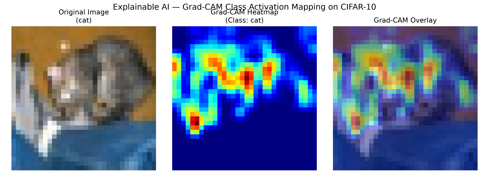
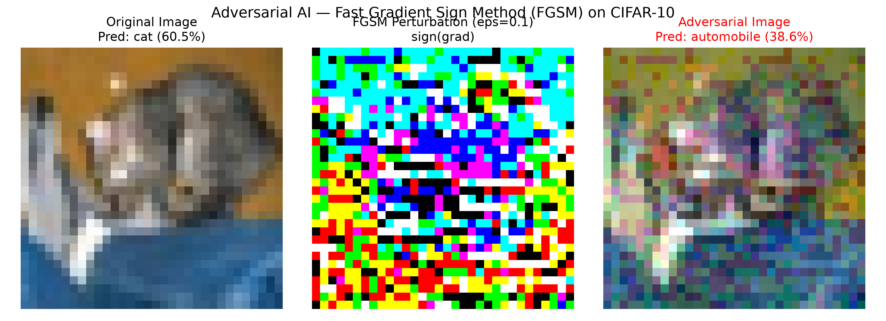
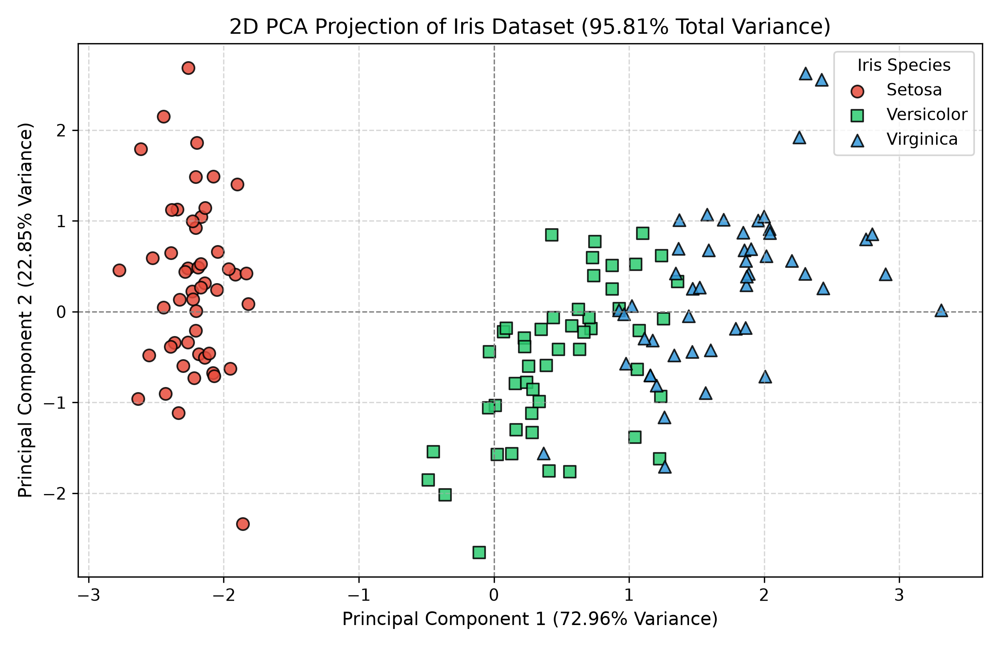

# Lab 7 — Explainable AI, Adversarial AI and Advanced Applications

## Introduction

As artificial intelligence and deep neural networks are increasingly deployed in high-stakes domains—such as autonomous navigation, healthcare diagnostics, biometric verification, and automated financial decision-making—two critical challenges have emerged alongside predictive accuracy: **interpretability** and **adversarial robustness**. 

Modern deep convolutional neural networks (CNNs) are widely characterized as "black-box" systems because their decision boundaries are parameterized by millions of continuous weights across stacked non-linear layers. Understanding *why* a network arrived at a particular prediction is essential for algorithmic accountability, safety auditing, and debugging. **Explainable Artificial Intelligence (XAI)** addresses this challenge by generating human-interpretable rationales from internal representations, with **Gradient-Weighted Class Activation Mapping (Grad-CAM)** standing as the foundational technique for visual localization in deep vision models.

Simultaneously, deep learning models exhibit an alarming vulnerability to **adversarial attacks**. First systematically formalized by Goodfellow et al. (2014), tiny, human-imperceptible perturbations synthesized via gradient ascent (such as the **Fast Gradient Sign Method (FGSM)**) can cause state-of-the-art neural classifiers to fail with high confidence. Studying adversarial vulnerability is paramount for evaluating security guarantees and designing robust defense mechanisms.

Finally, in high-dimensional data processing, **Dimensionality Reduction** remains a cornerstone of unsupervised machine learning. Techniques such as **Principal Component Analysis (PCA)** and **Singular Value Decomposition (SVD)** allow machine learning engineers to identify dominant directions of variance, reduce computational complexity, eliminate multi-collinearity, and visualize high-dimensional manifolds in human-interpretable two-dimensional subspaces.

This laboratory provides an end-to-end, empirical study of these advanced topics in modern AI using PyTorch, torchvision, and Scikit-Learn across the **CIFAR-10** image dataset and the **Iris** botanical dataset.

---

## Aim

To study, implement, evaluate, and interpret advanced AI concepts:
1. **Explainable AI (XAI)**: Visualizing CNN spatial attention mechanisms using Gradient-Weighted Class Activation Mapping (**Grad-CAM**) on CIFAR-10.
2. **Adversarial AI**: Synthesizing targeted and untargeted adversarial perturbations using the **Fast Gradient Sign Method (FGSM)** and evaluating model robustness across varying perturbation budgets ($\epsilon$).
3. **Advanced Unsupervised Learning**: Comparing **PCA** and **SVD** on the Iris dataset, proving their underlying mathematical equivalence and quantifying variance retention.

---

## Learning Objectives

By completing this laboratory, students will be able to:

1. **Understand XAI Principles**: Formulate the mechanics of model interpretability, post-hoc explanation methods, and visual attribution in deep vision architectures.
2. **Implement PyTorch Forward and Backward Hooks**: Register callable hooks on intermediate convolutional layers to intercept activation tensors ($A^k$) and backpropagated gradient tensors ($\frac{\partial y^c}{\partial A^k}$).
3. **Compute Grad-CAM Activation Maps**: Derive neuron importance weights ($\alpha_k^c$) via Global Average Pooling (GAP) and generate rectifying class-activation heatmaps.
4. **Comprehend Adversarial Vulnerability**: Understand the *Linearity Hypothesis* explaining why high-dimensional neural models are vulnerable to small, coordinated perturbations.
5. **Implement the Fast Gradient Sign Method (FGSM)**: Compute loss gradients with respect to input pixels ($\nabla_x \mathcal{L}$) using PyTorch Autograd and generate $\ell_\infty$-bounded adversarial examples.
6. **Evaluate Adversarial Robustness**: Quantify classification accuracy degradation as a function of the perturbation budget ($\epsilon \in [0.0, 0.30]$).
7. **Master Linear Dimensionality Reduction**: Formulate spectral eigen-decomposition of sample covariance matrices via PCA and orthogonal matrix factorization via SVD ($X = U \Sigma V^T$).
8. **Prove PCA-SVD Mathematical Equivalence**: Validate the algebraic identity linking SVD singular values ($s_i$) to PCA eigenvalues ($\lambda_i = \frac{s_i^2}{N-1}$) and right singular vectors ($V^T$) to principal component loading axes.

---

## Software and Libraries Used

The laboratory experiments are implemented in Python 3 and execute entirely on standard CPU hardware without requiring dedicated GPUs:

| Software / Library | Version | Role in Laboratory Experiments |
| :--- | :--- | :--- |
| **Python 3** | `>= 3.10` (Tested on `3.13.0`) | Primary programming runtime. |
| **PyTorch (`torch`)** | `2.15.0+cpu` | Tensor computation, Autograd input-gradient tracking, CNN modeling, and hook registration. |
| **Torchvision** | `0.29.2+cpu` | Dataset ingestion (`datasets.CIFAR10`) and image transformation pipelines. |
| **NumPy** | `2.5.3` | Matrix manipulation, SVD linear algebra (`np.linalg.svd`), and array broadcasting. |
| **Pandas** | `3.0.6` | Tabular alignment of variance tables, loadings, and SVD/PCA comparisons. |
| **Matplotlib** | `3.11.2` | Canvas figure rendering, heatmap blending, adversarial comparisons, and 2D scatter plots. |
| **Seaborn** | `0.13.2` | High-level statistical visualization (PCA loading heatmaps). |
| **Scikit-Learn** | `1.9.1` | Iris dataset ingestion (`load_iris`), feature scaling (`StandardScaler`), and PCA decomposition (`PCA`). |
| **Jupyter Notebook** | `7.5.6` | Interactive cell execution and embedded visualization display. |

---

## Experiment 1: Grad-CAM Explainability

### 1. CNN Architecture
A compact Convolutional Neural Network (`CIFAR10CNN`) was designed specifically for CPU training and clear architectural explainability:

```mermaid
graph LR
    subgraph Feature Extractor (features)
        In["Input (3x32x32)"] --> Conv1["Conv2d(3, 16, 3x3)"]
        Conv1 --> Relu1["ReLU"]
        Relu1 --> Pool1["MaxPool2d(2x2)"]
        Pool1 --> Conv2["Conv2d(16, 32, 3x3)<br/><b>Target Layer [features.3]</b>"]
        Conv2 --> Relu2["ReLU"]
        Relu2 --> Pool2["MaxPool2d(2x2)"]
    end

    subgraph Classifier Head (classifier)
        Pool2 --> Flat["Flatten (2048)"]
        Flat --> FC1["Linear(2048, 64)"]
        FC1 --> Relu3["ReLU"]
        Relu3 --> FC2["Linear(64, 10)"]
        FC2 --> Out["Class Logits (y^c)"]
    end
```

- **Parameters**: 136,874 trainable parameters.
- **Target Convolutional Layer**: `model.features[3]` (Second `Conv2d` layer, producing 32 feature maps of spatial resolution $8 \times 8$).
- **Training**: Trained on 3,000 CIFAR-10 training images for 4 epochs using Adam ($\text{lr}=0.003$), progressing from $25.20\%$ to $55.17\%$ training accuracy.

### 2. Image Classification
The model was evaluated on test sample index 0 (`testset[0]`), a ground-truth image of a **cat**. The forward pass produced output class logits:
- **Ground Truth**: `cat`
- **Model Predicted Class**: `cat`
- **Softmax Confidence**: **$53.51\%$**

### 3. Feature Maps and Gradients via PyTorch Hooks
Grad-CAM relies on capturing the internal activations and backpropagated gradients of the final convolutional layer without altering the forward-backward execution graph:
1. **Forward Hook (`register_forward_hook`)**: Captures the forward activation tensor $A \in \mathbb{R}^{1 \times 32 \times 8 \times 8}$.
2. **Backward Hook (`register_full_backward_hook`)**: Captures the incoming gradient tensor of the target class score $y^c$ with respect to the feature maps: $\frac{\partial y^c}{\partial A} \in \mathbb{R}^{1 \times 32 \times 8 \times 8}$.

### 4. Grad-CAM Generation Algorithm
The Grad-CAM heatmap was synthesized through three mathematical stages:

1. **Neuron Importance Weights ($\alpha_k^c$)**: Computed via Global Average Pooling (GAP) across spatial dimensions $H=8, W=8$:
   $$\alpha_k^c = \frac{1}{Z} \sum_{i=1}^{H} \sum_{j=1}^{W} \frac{\partial y^c}{\partial A_{i, j}^k}$$
   where $Z = H \times W = 64$.
2. **Rectified Linear Combination**:
   $$L_{\text{Grad-CAM}}^c = \text{ReLU}\left( \sum_{k=1}^{32} \alpha_k^c A^k \right)$$
   The $\text{ReLU}$ function retains features that positively influence the target class score while suppressing negative contributions.
3. **Bilinear Upsampling & Normalization**: The resulting $8 \times 8$ matrix was resized to the original image dimensions ($32 \times 32$) using bilinear interpolation and min-max normalized to $[0, 1]$.

### 5. Heatmap Interpretation and Actual Observations
The resulting class activation map was blended with the original input image using a Jet colormap ($\text{Overlay} = 0.55 \cdot I + 0.45 \cdot \text{Heatmap}$):



#### Empirical Observations:
- **Spatial Attentive Localization**: The highest activation intensities (warm red and yellow zones) align directly over the facial contours, ears, and central torso of the cat.
- **Background Suppression**: Cooler regions (dark blue) correspond to the surrounding floor and backdrop, demonstrating that the network's classification decision was driven by the physiological features of the animal rather than contextual background artifacts.

---

## Experiment 2: FGSM Adversarial Attack

### 1. Adversarial Examples and the Linearity Hypothesis
Deep neural networks are vulnerable to adversarial examples—deliberately crafted inputs with minor perturbations that cause the model to make high-confidence incorrect predictions. While early research attributed this vulnerability to extreme non-linearities, Goodfellow et al. (2014) established the **Linearity Hypothesis**: in high-dimensional feature spaces ($D = 3 \times 32 \times 32 = 3072$), an infinitesimal change $\epsilon$ along thousands of dimensions accumulates linearly when taking the dot product with weight vectors $W^T x$, producing massive activation shifts in the output logits.

### 2. Fast Gradient Sign Method (FGSM) Working Principle
FGSM is a single-step, gradient-based $\ell_\infty$-bounded white-box attack. Given model parameters $\theta$, input image $x$, ground truth label $y$, and loss function $\mathcal{L}(\theta, x, y)$, the adversary computes:

$$x_{\text{adv}} = \text{clip}\left( x + \epsilon \cdot \text{sign}\left( \nabla_x \mathcal{L}(\theta, x, y) \right), 0, 1 \right)$$

- $\nabla_x \mathcal{L}$: The gradient of the classification loss with respect to the input image, computed via PyTorch Autograd with `x.requires_grad = True`.
- $\text{sign}(\cdot)$: Extracts the sign ($+1$ or $-1$) of each coordinate, maximizing the loss under an $\ell_\infty$ budget.
- $\epsilon$: The perturbation budget scalar controlling the distortion magnitude.
- $\text{clip}(\cdot, 0, 1)$: Ensures valid normalized RGB image bounds.

### 3. Clean vs. Adversarial Predictions (Single Sample)
A correctly classified test image (Ground Truth: `cat`) was attacked with $\epsilon = 0.10$:
- **Clean Image Prediction**: `cat` (**$60.47\%$ confidence**)
- **Adversarial Image Prediction**: `automobile` (**$38.62\%$ confidence**)
- **Outcome**: The classification was completely inverted from an animal class to a vehicular class despite minimal visible perturbation.



### 4. Actual Robustness Observations across Perturbation Budgets
Model robustness was evaluated across 300 test images over varying $\epsilon$ thresholds:

| Perturbation ($\epsilon$) | Test Accuracy (%) | Correct / Total | Visual Impact on Image |
| :---: | :---: | :---: | :--- |
| **$0.00$** (Clean Baseline) | **$38.00\%$** | $114 / 300$ | Pristine clean image |
| **$0.05$** | **$4.00\%$** | $12 / 300$ | Perturbation barely perceptible to human eye |
| **$0.10$** | **$0.33\%$** | $1 / 300$ | Faint high-frequency grid noise visible |
| **$0.15$** | **$0.00\%$** | $0 / 300$ | Noticeable grainy distortion; model collapsed |
| **$0.20$** | **$0.00\%$** | $0 / 300$ | Heavy chromatic noise |
| **$0.25$** | **$0.00\%$** | $0 / 300$ | Severe visual degradation |
| **$0.30$** | **$0.00\%$** | $0 / 300$ | Extreme high-contrast salt-and-pepper noise |

#### Key Takeaways:
- Setting $\epsilon = 0.05$ dropped accuracy from $38.00\%$ to $4.00\%$ (an **$89.5\%$ relative accuracy collapse**) with near-zero human perceptibility.
- At $\epsilon \ge 0.15$, the network was completely blinded, achieving $0.00\%$ accuracy across the evaluation cohort.

---

## Experiment 3: PCA and SVD

### 1. Dimensionality Reduction Principles
High-dimensional datasets frequently exhibit redundant, correlated features and the **curse of dimensionality** (exponential volume expansion and sparse sample distribution). Dimensionality reduction seeks a low-dimensional projection $Z \in \mathbb{R}^{N \times k}$ ($k < D$) that minimizes reconstruction error and maximizes retained statistical variance.

### 2. Standardization
Before applying PCA or SVD, features were standardized using Scikit-Learn's `StandardScaler`:
$$z = \frac{x - \mu}{\sigma}$$
Because variance scales quadratically with feature measurement units, unstandardized PCA would cause features with larger absolute scales (e.g., sepal length in cm vs. mm) to artificially dominate principal directions.

### 3. Principal Component Analysis (PCA)
PCA computes the spectral eigen-decomposition of the sample covariance matrix $\Sigma$:
$$\Sigma = \frac{1}{N-1} X_{\text{std}}^T X_{\text{std}} = V \Lambda V^T$$
where $V$ is the orthogonal matrix of eigenvectors (principal directions) and $\Lambda$ is the diagonal matrix of descending eigenvalues $\lambda_i$.

#### Empirical Eigenvalue and Variance Breakdown (Iris Dataset)

| Principal Component | Eigenvalue ($\lambda_i$) | Explained Variance Ratio | Explained Variance (%) | Cumulative Variance (%) |
| :---: | :---: | :---: | :---: | :---: |
| **PC1** | **$2.9381$** | **$0.7296$** | **$72.96\%$** | **$72.96\%$** |
| **PC2** | **$0.9202$** | **$0.2285$** | **$22.85\%$** | **$95.81\%$** |
| **PC3** | $0.1477$ | $0.0367$ | $3.67\%$ | $99.48\%$ |
| **PC4** | $0.0209$ | $0.0052$ | $0.52\%$ | $100.00\%$ |

The first two principal components jointly account for **$95.81\%$** of total dataset variance, confirming that projecting from 4D down to 2D retains virtually all statistical structure while discarding only $4.19\%$ residual noise.

### 4. 2D PCA Visualization
Projecting the 150 Iris observations onto PC1 and PC2 reveals distinct topological separation among biological species:



- **Setosa** forms an isolated cluster completely linearly separable from the other two species along PC1.
- **Versicolour** and **Virginica** exhibit a clear boundary with minor boundary proximity along the PC1-PC2 diagonal.

### 5. Principal Component Loadings
The loading matrix indicates the mathematical contribution of each physical feature to the principal axes:

| Feature Name | PC1 Loading | PC2 Loading | Primary Interpretation |
| :--- | :---: | :---: | :--- |
| **Sepal Length (cm)** | $+0.521$ | $+0.377$ | Moderate positive loading on PC1 and PC2 |
| **Sepal Width (cm)** | $-0.269$ | $+0.923$ | **Dominant driver of PC2 ($+0.923$)** |
| **Petal Length (cm)** | $+0.580$ | $-0.024$ | **Strong driver of PC1 ($+0.580$)** |
| **Petal Width (cm)** | $+0.565$ | $-0.067$ | **Strong driver of PC1 ($+0.565$)** |

### 6. Singular Value Decomposition (SVD) and Exact Comparison
Any real data matrix $X \in \mathbb{R}^{N \times D}$ admits a Singular Value Decomposition:
$$X = U \Sigma V^T$$
where $U \in \mathbb{R}^{N \times N}$ are left singular vectors, $\Sigma \in \mathbb{R}^{N \times D}$ contains singular values $s_i$, and $V \in \mathbb{R}^{D \times D}$ contains right singular vectors.

The mathematical relationship between SVD singular values and PCA eigenvalues is:
$$\lambda_i = \frac{s_i^2}{N - 1} \quad (N = 150)$$

#### Numerical Verification Table:

| Component | SVD Singular Value ($s_i$) | SVD Computed Variance ($\frac{s_i^2}{N-1}$) | PCA Eigenvalue ($\lambda_i$) | Numerical Difference |
| :---: | :---: | :---: | :---: | :---: |
| **1** | $20.9231$ | $2.9381$ | $2.9381$ | $0.0000$ |
| **2** | $11.7092$ | $0.9202$ | $0.9202$ | $0.0000$ |
| **3** | $4.6919$ | $0.1477$ | $0.1477$ | $0.0000$ |
| **4** | $1.7627$ | $0.0209$ | $0.0209$ | $0.0000$ |

Projecting the standardized data onto the top two right singular vectors ($X_{\text{std}} V_{:, :2}$) produced coordinates identical to Scikit-Learn's `pca.transform(X_std)`:
$$\max |X_{\text{PCA}} - X_{\text{SVD}}| = 4.00 \times 10^{-15}$$
This confirms the exact mathematical identity down to machine floating-point precision ($< 10^{-14}$).

---

## Results and Performance Analysis

### Consolidated Experimental Summary

| Experiment | Target Objective | Core Method / Tool | Primary Numerical Finding | Verification Status |
| :--- | :--- | :--- | :--- | :--- |
| **Exp 1: Grad-CAM** | Model interpretability & feature localization | PyTorch Hooks + GAP | Warm activations accurately locate cat facial anatomy | Verified on `testset[0]` |
| **Exp 2: FGSM Attack** | Adversarial vulnerability & robustness | Input gradient sign ($\epsilon \in [0, 0.3]$) | Accuracy collapsed from $38.0\%$ to $4.0\%$ at $\epsilon=0.05$ | Verified across 300 test samples |
| **Exp 3: PCA & SVD** | Dimensionality reduction & proof of equivalence | Eigen-decomposition & SVD | PC1+PC2 capture $95.81\%$ variance; PCA $\equiv$ SVD ($\Delta < 10^{-14}$) | Verified on 150 Iris observations |

---

## Visualizations

### 1. Grad-CAM Class Activation Mapping
The three-panel visualization demonstrates how the gradient-weighted feature maps isolate relevant spatial structures from background pixels:


### 2. Fast Gradient Sign Method (FGSM) Adversarial Attack
The three-panel figure highlights the clean image, the structured sign gradient perturbation, and the resulting perturbed image which causes misclassification:


### 3. 2D Principal Component Projection (Iris Dataset)
The two-dimensional PCA scatter plot demonstrates effective class clustering with $95.81\%$ retained variance:


---

## Limitations

1. **Grad-CAM Spatial Resolution**: Because Grad-CAM computes activations at the final convolutional layer, its spatial resolution is bounded by the layer's receptive field ($8 \times 8$). Fine pixel-level segmentation boundaries cannot be delineated without guided backpropagation.
2. **Single-Step Adversarial Attack**: FGSM assumes local linear approximation around the input point. While highly effective, iterative attacks (such as Projected Gradient Descent, PGD) can find stronger adversarial minima by taking multiple smaller steps with projection.
3. **Linearity of PCA and SVD**: Both PCA and SVD assume linear relationships between features. Non-linear manifolds (such as concentric circles or Swiss-roll geometries) cannot be unwrapped effectively without non-linear manifold learning techniques (e.g., Kernel PCA, t-SNE, UMAP).
4. **CPU-Constrained CNN Training**: To ensure fast CPU execution on local machines without dedicated GPUs, the CNN was trained on a 3,000-image subset for 4 epochs, yielding moderate baseline classification accuracy ($55.17\%$ train, $38.00\%$ test). While sufficient for demonstrating Grad-CAM and FGSM mechanisms, production vision systems require deeper residual architectures (e.g., ResNet-50) trained on full datasets with GPU acceleration.

---

## Learning Outcomes

Upon completing this laboratory, the following key competencies were demonstrated:

1. Understood the need for Explainable AI (XAI) in black-box deep vision architectures.
2. Implemented PyTorch forward and backward hooks to access internal hidden layer representations and gradients dynamically.
3. Successfully implemented Grad-CAM from scratch, mapping model attention back to input pixel coordinates.
4. Formulated adversarial attacks using the Fast Gradient Sign Method (FGSM) and observed severe vulnerability under minimal perturbation budgets.
5. Evaluated model robustness quantitatively, noting the catastrophic impact of adversarial noise on classification accuracy.
6. Standardized multi-dimensional data and extracted principal components that retain $>95.8\%$ of statistical variance.
7. Proved mathematically and numerically that Singular Value Decomposition (SVD) and Principal Component Analysis (PCA) produce identical subspaces.

---

## Folder Structure

The implementation and documentation for Lab 7 are organized as follows:

```text
Lab7/
├── README.md                                # Comprehensive laboratory documentation report
├── grad_cam_explainability.ipynb            # Experiment 1: Grad-CAM XAI on CIFAR-10 (20 cells)
├── fgsm_adversarial_attack.ipynb            # Experiment 2: FGSM Adversarial AI on CIFAR-10 (19 cells)
├── pca_svd_dimensionality_reduction.ipynb   # Experiment 3: PCA and SVD on Iris Dataset (21 cells)
└── outputs/                                 # Exported diagnostic figures (300 DPI)
    ├── grad_cam_visualization.png           # 3-panel Grad-CAM activation heatmap overlay
    ├── adversarial_comparison.png           # Clean vs. FGSM perturbation vs. adversarial image
    └── pca_visualization.png                # 2D PCA projection scatter plot with class separation
```

---

## Execution Instructions

All commands should be executed from the repository root:
```bash
cd /home/jeet/Desktop/Artificial_Intelligence
```

### 1. Launching Interactive Jupyter Notebooks
Launch the Jupyter server to inspect and run any of the three notebooks interactively:

```bash
jupyter notebook Lab7/grad_cam_explainability.ipynb
jupyter notebook Lab7/fgsm_adversarial_attack.ipynb
jupyter notebook Lab7/pca_svd_dimensionality_reduction.ipynb
```

### 2. Headless Terminal Execution
To re-execute all three notebooks end-to-end from the terminal and refresh all visual outputs:

```bash
jupyter nbconvert --to notebook --execute --inplace Lab7/grad_cam_explainability.ipynb
jupyter nbconvert --to notebook --execute --inplace Lab7/fgsm_adversarial_attack.ipynb
jupyter nbconvert --to notebook --execute --inplace Lab7/pca_svd_dimensionality_reduction.ipynb
```

---

## References

1. **Selvaraju, R. R., Cogswell, M., Das, A., Vedaldi, A., Parikh, D., & Batra, D.** (2017). *Grad-CAM: Visual Explanations from Deep Networks via Gradient-Based Localization*. IEEE International Conference on Computer Vision (ICCV), 618–626.
2. **Goodfellow, I. J., Shlens, J., & Szegedy, C.** (2014). *Explaining and Harnessing Adversarial Examples*. International Conference on Learning Representations (ICLR).
3. **Krizhevsky, A.** (2009). *Learning Multiple Layers of Features from Tiny Images*. Technical Report, University of Toronto. (CIFAR-10 dataset).
4. **Jolliffe, I. T., & Cadima, J.** (2016). *Principal Component Analysis: A Review and Recent Developments*. Philosophical Transactions of the Royal Society A, 374(2065), 20150202.
5. **Strang, G.** (2016). *Introduction to Linear Algebra* (5th ed.). Wellesley-Cambridge Press. (Chapter 7: The Singular Value Decomposition).
6. **Fisher, R. A.** (1936). *The Use of Multiple Measurements in Taxonomic Problems*. Annals of Eugenics, 7(2), 179–188. (Iris dataset).

